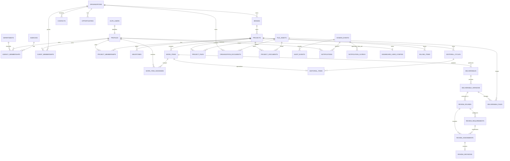

# OMNIA Craft 2.0 — Action Plan

> Documento de arquitectura y ejecución. Fecha de corte de la investigación: 22 de agosto de 2026. No es una especificación de UI ni autoriza implementar fases. El legacy se usa como evidencia de dominio, no como base de código.

## 1. Executive Summary

OMNIA Craft 2.0 debe construirse como un sistema operativo de agencia para una sola agencia —OMNIA— con dos superficies aisladas: una aplicación interna y un portal para las organizaciones cliente. Desde el MVP, una organización admite múltiples usuarios cliente, pero cada acceso a proyecto se concede explícitamente; pertenecer a la organización no autoriza todos sus proyectos. La jerarquía canónica es Agency → Organization → Brand → Project, sin convertirse prematuramente en un SaaS multiagencia.

La recomendación central es conservar el scaffold Vite + React + TypeScript y construir, desde cero, un backend Supabase local-first cuya fuente de verdad sean migraciones versionadas. La autorización se modelará por membresías y capacidades con alcance; `profiles` no contendrá un rol global editable. RLS será la autoridad para acceso a filas, RPC transaccionales serán la autoridad para cambios de estado, Storage será privado por defecto y Realtime se habilitará sólo donde exista una necesidad viva demostrable.

El primer MVP utilizable termina en la **Phase 9**: identidad segura, CRM mínimo, clientes, proyectos, trabajo personal, dashboard configurable, operación editorial, entregables, revisiones, aprobaciones, archivos y un portal cliente limitado pero funcional. Mensajería, push, billing avanzado, analytics, IA, automatizaciones y publicación social quedan fuera del MVP.

Decisiones principales:

- adoptar React Router, TanStack Query, React Hook Form, Zod y Supabase JS;
- no adoptar Refine; sí adoptar sus conceptos de providers/adapters;
- adoptar React Grid Layout v2 únicamente para el dashboard;
- no añadir dnd-kit hasta que exista un caso Kanban/lista/calendario validado;
- normalizar a npm en Phase 0 para cumplir el contrato `npm run dev`;
- tratar `founder` sólo como metadata societaria no autoritativa; los roles operativos son `agency_director`, `project_manager` y `producer`/`contributor`;
- limitar al PM a proyectos asignados y conceder cualquier acceso CRM adicional mediante capabilities explícitas;
- separar agency, organization y project memberships; organization membership nunca implica project authorization;
- usar política archive-first y comandos explícitos/auditados para overrides y permanent delete;
- fijar `America/Mexico_City` como timezone base, conservando UTC y contexto temporal donde corresponda;
- usar tipos de base generados y versionados;
- probar RLS desde la primera tabla, incluidos negativos, cruce entre clientes y escalación de privilegios;
- diferir toda migración legacy hasta estabilizar el modelo nuevo.

## 2. Product Vision

OMNIA Craft será el registro operativo compartido de la agencia: quién necesita hacer qué, para qué cliente y proyecto, cuál es el estado verificable del trabajo, qué versión fue entregada, quién la revisó y qué puede ver o decidir cada actor.

### Principios de producto

1. **Una fuente de verdad por concepto.** Una entrega, una decisión y una membresía tienen representación canónica.
2. **Seguridad por construcción.** La UI comunica permisos; nunca los concede.
3. **Flujos, no CRUD suelto.** Las transiciones relevantes son comandos de negocio atómicos.
4. **Contexto donde se trabaja.** Cliente, proyecto, trabajo, archivo y conversación permanecen relacionados.
5. **Personalización acotada.** Los usuarios organizan su dashboard sin programar componentes ni eludir RLS.
6. **Local reproducible.** Un clone limpio puede reconstruir DB, seed, Functions y frontend.
7. **Evolución por evidencia.** Analytics, IA, integraciones y offline llegan después de datos y eventos confiables.

### Estado real del repositorio nuevo

| Área | Hallazgo | Consecuencia para Phase 0 |
|---|---|---|
| Runtime | React 19.2.8, Vite 8.2, TypeScript 6, ESM | Base moderna válida; verificar compatibilidad de cada nueva dependencia |
| Gestor | npm 11; `package-lock.json` único | Normalización ejecutada en Phase 0 |
| Calidad | Oxlint, Vitest/Testing Library y scripts `dev`, `typecheck`, `lint`, `test`, `build`, `preview` | Gates frontend disponibles desde Phase 0 |
| Producto | Foundation con Router, Query provider, env Zod, error boundary y shells placeholders; sin Supabase | Arquitectura lista para Phase 1 sin dominio prematuro |
| Visual | Logos OMNIA, logos de departamentos, Lexend, Quicksand y tokens de marca | Son la fuente visual inicial; todavía no forman un sistema de componentes |
| Scaffold | Imports inexistentes eliminados; favicons válidos y assets OMNIA preservados | Corregido en Phase 0 |
| Git | La carpeta inspeccionada no expone metadatos `.git` | Antes de implementar, confirmar rama/repositorio y protección de cambios |
| Backend | No existe `supabase/` | Crear baseline local desde cero en Phase 1 |

## 3. Legacy Lessons

El análisis obligatorio es [OMNIA_CRAFT_LEGACY_ANALYSIS.md](./OMNIA_CRAFT_LEGACY_ANALYSIS.md). Sus 20 tablas, 13 módulos y 4 roles describen alcance recuperado; no prescriben el nuevo esquema.

### Capability disposition

| Capacidad legacy | Estado | Conservar | Rediseñar | Eliminar | Motivo |
|---|---|---:|---:|---:|---|
| Login y perfil | Parcial | Sí | Sí | No | Sesión válida; rol en perfil y token duplicado son inseguros |
| Administración de usuarios | No auditable | Sí | Sí | No | Function sin fuente y autorización no demostrada |
| Roles directora/PM/fundador/cliente | Evidencia legacy | Sí | Sí | No | Directora/PM migran a roles con scope; `fundador` queda sólo como metadata no autoritativa; cliente usa memberships |
| Plantillas de contenido | Funcional | Sí | Sí | No | Encaja en Editorial; separar plantilla de pieza/variante |
| Ciclo → semana → pieza | Funcional con deuda | Sí | Sí | No | Preservar lenguaje si negocio confirma semanas; evitar cuatro semanas rígidas |
| Postulación y asignación | Parcial | Sí | Sí | No | Requiere elegibilidad y aceptación atómica |
| Entregas versionadas | Parcial | Sí | Sí | No | Unificar metadata/archivos y versionado |
| Revisión dual | Rota | Sí | Sí | No | Modelar ronda, revisores requeridos y decisiones atómicas |
| Solicitudes de reunión | Funcional | Sí | Sí | No | Puede ser tipo de solicitud/actividad, no necesariamente módulo propio |
| Dashboard interno | Costoso | Sí | Sí | No | Queries agregadas y personalización controlada |
| Clientes y proyectos | Parcial | Sí | Sí | No | Organización cliente, contactos y membresías inequívocas |
| Equipo de proyecto | Parcial | Sí | Sí | No | Scope de proyecto explícito y mínimo privilegio |
| Portal cliente | Parcial | Sí | Sí | No | Separación de rutas, navegación y RLS; varios usuarios opcionales |
| Decisión cliente | Rota | Sí | Sí | No | Evento + transición RPC; nunca `UPDATE` directo genérico |
| Pagos/parcialidades | Reglas débiles | Condicional | Sí | No | Sólo tracking inicialmente; no fingir contabilidad |
| Documentos | Scope ambiguo | Sí | Sí | No | Cada documento debe pertenecer a un recurso válido |
| Chat | Cliente inalcanzable | Later | Sí | No | Canales/membresías; no mezclar con comentarios de trabajo |
| Notificaciones in-app | Vulnerable | Sí | Sí | No | Destinatario derivado de evento autorizado |
| Web Push | Vulnerable | Later | Sí | No | Plantillas de payload y workers versionados; opt-in |
| Realtime global + polling | Falso/parcial | No | Sí | Sí | Sustituir por invalidación selectiva, Broadcast o polling medido |
| Storage público/transversal | Crítico | No | Sí | Sí | Buckets privados, paths opacos, policies por recurso y URL firmada |
| Audit log escrito por cliente | No confiable | No | Sí | Sí | Auditoría generada server-side dentro de la transacción |
| PWA instalable sin offline | Parcial | Later | Sí | No | Separar install/push de requisito offline |

### Fallos que la arquitectura debe hacer imposibles

- `profiles` nunca almacena autoridad editable por el propio usuario.
- Ningún cliente puede leer perfiles, calendarios o trabajo interno sólo por estar autenticado.
- El actor no proporciona `recipient_id` ni payload libre a una operación de notificación/push.
- Ninguna transición de negocio crítica es una cadena de mutations independientes desde React.
- Ningún bucket sensible es público ni autoriza por nombre de archivo suministrado.
- La UI y RLS comparten el mismo vocabulario de capacidades, pero RLS/RPC siguen siendo la autoridad.
- No se aceptan tipos de DB manuales ni fallbacks a columnas inexistentes.
- No existe SQL estructural fuera de migraciones versionadas.
- Una subscription no se considera funcional sin publicación/autorización y test de recepción.
- Las páginas coordinan casos de uso; no contienen a la vez queries, política, transiciones y render.
- Ninguna fase de datos cierra sin pruebas RLS positivas, negativas, cross-client y privilege-escalation.

## 4. Henry Functional Benchmark

Henry se analiza sólo desde su información pública. Su sitio describe calendario social conectado, Mi Espacio, Content Manager, dashboard de agencia, proyectos con milestones, aprobaciones por enlace, chat por marca, analytics, Ads, automatizaciones e IA con contexto por cliente. Es benchmark de integración del producto, no fuente de UI, copy, assets o implementación. Fuente: [Henry](https://www.henry.cm/).

| Capacidad | Legacy | Henry benchmark | OMNIA Craft futuro | Prioridad |
|---|---|---|---|---|
| Dashboard de agencia | Dos dashboards fijos | Pendientes, clientes esperando y reportes | Resumen personal accionable, luego liderazgo | MVP |
| Mi Espacio | Piezas y pendientes | Trabajo por fecha, marca y responsable | Inbox personal unificado de work items/reviews | MVP |
| Clientes/marcas | Cliente + owner | Contexto por marca | Organización, contactos, brief y acceso | Core |
| CRM/pipeline | Ausente | No es foco público principal | Accounts, contacts, opportunities y actividad | MVP |
| Proyectos | Parcial | Milestones, tareas y progreso | Proyectos, hitos, miembros y salud | Core |
| Calendario editorial | Ciclos/semanas/piezas | Calendario drag/drop multired | Calendario editorial sin publicación social inicial | MVP |
| Parrilla presentable | Vista operativa | Parrilla/preview para cliente | Vista de revisión y aprobación basada en datos propios | V1 |
| Programación social | Ausente | Instagram/TikTok/Facebook/LinkedIn | Integración posterior, sólo si negocio la prioriza | Later |
| Content Manager | Storage fragmentado | Assets por marca/campaña/formato | Catálogo privado con metadata y enlaces a recursos | MVP |
| Entregables/versiones | Dos modelos | Archivos y aprobaciones conectados | Núcleo único de versiones, rondas y decisiones | Core |
| Aprobación cliente | UI rota | Link sin cuenta | Portal autenticado primero; enlace invitado sólo con threat model | MVP |
| Comunicación | Chat parcial | Canal por marca y threads | Comentarios contextuales primero; chat después | V1 |
| Analytics social | Sin integración | Multiplataforma | Reportes internos/manuales antes de conectores | Later |
| Meta Ads | Ausente | Métricas/gestión de Ads | No construir hasta CRM y permisos de integración estables | Later |
| Reportes vivos | Cards simples | KPIs y resumen ejecutivo | Read models auditables y exportación | V1 |
| Automatizaciones | Ausentes | Workflows | Reglas sobre eventos versionados | Later |
| IA contextual | Ausente | Voz/contexto por cliente | Retrieval y generación con consentimiento/auditoría | Later |
| Billing | Tracking parcial | No es foco público | Tracking de cobros, no contabilidad | V1 |
| PWA/offline | Instalable, sin offline | No determinante | Mobile responsive; offline sólo con caso validado | Later |

**Conclusión:** copiar la amplitud de Henry antes de estabilizar identidad, CRM, proyectos y aprobaciones reproduciría el problema legacy. El valor a adoptar es la continuidad entre marca → trabajo → asset → aprobación → reporte.

## 5. Reference Repository Analysis

### A. twentyhq/twenty — CRM moderno

Estudiar conceptualmente People, Companies, Opportunities, Tasks/Notes, relaciones, objetos/campos configurables, vistas guardadas, filtros, layouts, actividad y permisos. Twenty separa registros de su metadata de presentación; sus vistas guardan layout, filtros, orden y visibilidad. Para OMNIA se adoptan `organization/contact/opportunity/activity` y vistas guardadas sólo cuando haya demanda; no se adopta un motor completo de objetos dinámicos. Fuentes: [objetos](https://docs.twenty.com/user-guide/data-model/capabilities/objects), [vistas y pipelines](https://docs.twenty.com/user-guide/views-pipelines/overview), [layout](https://docs.twenty.com/getting-started/core-concepts/layout), [permisos](https://docs.twenty.com/user-guide/permissions-access/capabilities/permissions).

### B. makeplane/plane — organización del trabajo

Estudiar la jerarquía workspace → project → work item, membresías a varios niveles, estados, assignees, ciclos, módulos, vistas, filtros, comentarios, attachments, actividad y analytics. Para OMNIA: proyecto como contenedor, work item como unidad canónica, ciclo editorial como planificación temporal y módulo/milestone como agrupación opcional. No copiar el backend ni su complejidad multi-producto. Fuentes: [documentación Plane](https://docs.plane.so/), [modelo de proyecto](https://developers.plane.so/api-reference/project/overview), [manual de operación](https://plane.so/operating-manual).

### C. refinedev/refine — abstracciones de aplicación

Refine demuestra interfaces útiles: Data Provider, Auth Provider, Access Control Provider, Live Provider, Audit Log Provider, recursos y routing. Su Data Provider usa TanStack Query y su integración Supabase acelera CRUD, pero los flujos OMNIA están dominados por RLS, RPC y estados, no CRUD genérico. Además, el Access Control Provider sólo controla UI si se envuelven rutas/componentes; no reemplaza seguridad backend. Recomendación: **Opción B — no usar Refine, adoptar conceptos similares** mediante adapters locales pequeños. Fuentes: [Data Provider](https://refine.dev/core/docs/data/data-provider/), [Access Control Provider](https://refine.dev/core/docs/authorization/access-control-provider/), [Live Provider](https://refine.dev/core/docs/realtime/live-provider/), [Supabase](https://refine.dev/core/docs/data/packages/supabase/).

### D. react-grid-layout/react-grid-layout — dashboard

La v2 es TypeScript-first, serializable, responsive por breakpoints y soporta añadir/quitar, mover, redimensionar, toolbox y límites de tamaño. Para un proyecto nuevo debe usarse su API v2/hook, no el wrapper legacy. El layout se guarda como JSONB por usuario; el registro de widgets permanece en código. Fuente: [React Grid Layout](https://github.com/react-grid-layout/react-grid-layout).

### E. clauderic/dnd-kit — interacciones futuras

dnd-kit es adecuado para listas, múltiples contenedores, sensores de teclado/touch y ordenamiento accesible. No aporta valor adicional al dashboard cubierto por React Grid Layout. Mantener como candidato para Kanban, prioridades ordenables o calendario editorial sólo cuando el caso de uso y sus reglas de persistencia estén definidos. Fuente: [dnd-kit](https://github.com/clauderic/dnd-kit).

### F. supabase/cli + documentación oficial — backend

Es la fuente primaria: `init`, stack Docker local, migraciones, seed, `db reset`, Auth/Storage/Realtime/Functions locales, secrets, tipos, lint/advisors y pgTAP. Al corte, la última release estable observada es CLI **v2.115.0**; introdujo pg-delta por defecto y hace fallar `supabase test db` si no encuentra tests, ambos comportamientos favorables pero que deben fijarse y revisarse al ejecutar Phase 1. Fuentes: [release v2.115.0](https://github.com/supabase/cli/releases/tag/v2.115.0), [workflow local](https://supabase.com/docs/guides/local-development/cli-workflows), [testing](https://supabase.com/docs/guides/local-development/testing/overview).

### G. usebasejump/supabase-test-helpers — pruebas RLS

Ofrece `create_supabase_user`, `authenticate_as`, `authenticate_as_service_role`, `clear_authentication` y checks de RLS. Recomendación: pilotarlo sólo en el esquema de tests y dentro de transacciones; no instalarlo en producción. Encapsularlo detrás de helpers OMNIA para fixtures de directora/PM/colaborador/cliente A/cliente B. Si su extensión/dbdev complica CI o queda sin mantenimiento, sustituir la capa OMNIA por helpers propios sin reescribir los casos. Fuente: [supabase-test-helpers](https://github.com/usebasejump/supabase-test-helpers).

### H. shadcn-ui/ui — primitives y composición

Estudiar sidebar componible, dialogs, forms, dropdowns, charts y la guía de data tables sobre TanStack Table. Adoptar componentes de forma selectiva como código propio, conectados a tokens OMNIA y a una única familia de primitives accesibles. No copiar blocks, estética, copy ni crear un “tema shadcn”. Fuentes: [sidebar](https://ui.shadcn.com/docs/components/aria/sidebar), [data table](https://ui.shadcn.com/docs/components/base/data-table), [licencia MIT](https://github.com/shadcn-ui/ui/blob/main/LICENSE.md).

## 6. Reference Repository Decision Matrix

| Repo | Qué estudiar | Qué NO estudiar | Adoptar dependencia | Solo referencia | Licencia/riesgo | Fase |
|---|---|---|---|---:|---|---|
| `twentyhq/twenty` | Accounts, people, opportunities, metadata, vistas, actividad, permisos | Backend completo, motor multi-tenant, Enterprise | No | Sí | AGPL-3.0; no copiar código ni docs | 3, 12 |
| `makeplane/plane` | Workspace/project/work item, ciclos, módulos, roles, views, comments, activity | Monorepo, despliegue y features ajenas | No | Sí | AGPL-3.0 y posibles archivos comerciales; inspección conceptual | 4, 6 |
| `refinedev/refine` | Providers, resources, routing, Supabase CRUD | Presets UI, generadores y abstracción universal | No | Sí | MIT; riesgo principal: indirection/lock-in conceptual | 0, 2 |
| `react-grid-layout/react-grid-layout` | v2 hooks, responsive, toolbox, serialize, add/remove | API legacy y uso fuera del dashboard | Sí, al iniciar Phase 5 | No | MIT; verificar React 19, bundle, touch/a11y | 5 |
| `clauderic/dnd-kit` | Sensores y sortable multi-container | Dashboard grid | No en MVP; candidato | Sí | MIT; complejidad de persistencia/keyboard UX | 6 o Later |
| `supabase/cli` + docs | Local stack, migrations, seed, Auth, Storage, Realtime, Functions, tests, types | Dashboards manuales como fuente de schema | Sí: CLI dev + Supabase JS | No | Open source; APIs/config cambian, fijar versión | 1–17 |
| `usebasejump/supabase-test-helpers` | Usuarios fake, impersonation y RLS checks | Extensión en producción | Piloto sólo tests | No | MIT; actividad/versionado modestos, encapsular | 1–2 |
| `shadcn-ui/ui` | Primitives accesibles y composición | Identidad visual, blocks completos | Selectivo, no framework monolítico | Sí | MIT con preservación de licencia; código queda bajo mantenimiento propio | 0, 3–14 |

**Regla de contexto:** futuras fases no vuelven a clonar ni explorar estos repos. Se abren únicamente los links y archivos citados en la fila de la fase correspondiente.

## 7. Skills Registry

Se encontraron 12 skills reales bajo `.agents/skills/`. Las copias detectadas bajo `.claude/skills/` tienen los mismos hashes y no deben volver a leerse.

| Skill | Qué hace | Cuándo usar | Fase propuesta | Prioridad |
|---|---|---|---|---|
| `code-security` | Checklist OWASP, secrets, auth, DB, archivos y red | Toda fase con inputs, Auth, Storage, Functions o CI | 0–17 | Crítica |
| `find-skills` | Descubre skills externas | Sólo si falta una capacidad especializada | Según bloqueo | Baja |
| `impeccable` | Diseña/revisa superficies con modo Operate y craft visual | Diseño de shell, dashboard, portal y pulido | 3–5, 9, 14 | Alta UI |
| `improve-codebase-architecture` | Detecta módulos superficiales y seams | Cuando el código ya tenga historial y fricción; no en scaffold | 7, 15 | Media |
| `supabase` | Reglas actuales de CLI, Auth, RLS, Functions, Storage y Realtime | Cualquier trabajo Supabase; revisar changelog primero | 1–17 | Crítica |
| `supabase-postgres-best-practices` | Schema, índices, queries, RLS, locking y diagnóstico | Antes de cada migración o cambio SQL | 1–17 | Crítica |
| `ui-ux-pro-max` | Guía buscable de UX, accesibilidad, responsive y charts | Arquitectura de información y surfaces nuevas | 3–5, 9, 12, 14 | Alta UI |
| `vercel-composition-patterns` | APIs React componibles y providers desacoplados | Shells, widget registry y primitives complejos | 0, 5, 9 | Alta |
| `vercel-react-best-practices` | Waterfalls, bundle, fetching y renders | Cada feature React y gate de performance | 0, 3–15 | Alta |
| `verification-before-completion` | Exige evidencia fresca antes de cerrar | Gate de todas las fases | 0–17 | Crítica |
| `vite` | Configuración Vite/ESM y compatibilidad v8 | Foundation, env, build, PWA | 0–1, 14, 17 | Alta |
| `web-design-guidelines` | Auditoría UI accesible y consistente | Gate de superficies listas | 3–5, 9, 12, 14 | Alta UI |

## 8. Proposed Product Scope

### Capas de alcance

| Prioridad | Capacidades |
|---|---|
| Core | Identity, memberships separadas por agency/organization/project, capabilities, client isolation, organizations, brands, projects, work items, deliverable versions, review decisions, files metadata, audit/domain events |
| MVP | Auth interno/cliente multiusuario, CRM mínimo, organizaciones/marcas/contactos, proyectos/equipo explícito, Mi Espacio, dashboard configurable básico, editorial, entregas/revisión/aprobación, Storage privado, portal cliente y notificaciones in-app mínimas |
| V1 | Comentarios más ricos, chat, Realtime selectivo para señales live, billing tracking, documentos, analytics/reportes, vistas guardadas |
| Later | Publicación social, Meta Ads, automatizaciones, IA contextual, push, PWA offline, integraciones externas |
| Fuera de alcance inicial | SaaS multiagencia, contabilidad/facturación fiscal, nómina, DAM enterprise, editor de video, BI general, constructor arbitrario de widgets |

### Qué no construir todavía

- IA antes de tener permisos, contexto de cliente y eventos auditables.
- Social publishing o Meta Ads antes de estabilizar CRM/editorial y consentimiento de integraciones.
- Dashboards ejecutivos complejos antes de contar con datos confiables y volumen real.
- Automatizaciones antes de definir catálogo de eventos, idempotencia y reintentos.
- Offline/PWA avanzada antes de decidir qué datos pueden persistir de forma segura en dispositivo.
- Links públicos de aprobación antes de diseñar expiración, revocación, rate limits y auditoría.
- Contabilidad, conciliación bancaria, impuestos o CFDI bajo el nombre ambiguo “pagos”.
- Motor de objetos/campos custom estilo CRM genérico.
- Multi-tenancy para vender a otras agencias.

## 9. MVP Definition

### Incluye

- login e invitación controlada para equipo y cliente;
- perfiles sin autoridad editable, memberships y permisos RLS probados;
- organizaciones cliente, contactos y pipeline CRM mínimo;
- proyectos, miembros, hitos y work items con Mi Espacio;
- dashboard personalizable con un conjunto pequeño de widgets de código;
- planificación editorial, asignación, entregas versionadas, revisión interna y aprobación cliente;
- archivos privados, metadata validada y URLs firmadas;
- portal cliente con proyectos, progreso, entregables, comentarios/decisiones y documentos esenciales;
- usuarios cliente múltiples por organización, cada uno con project memberships y capabilities independientes;
- audit events y notificaciones in-app persistidas derivadas de eventos —nueva tarea, entrega por revisar, entrega aprobada, cambios solicitados y aprobación pendiente— aunque Realtime, push y chat queden después.

### No incluye

Chat en tiempo real, social publishing, Ads, analytics multicanal, reportes automáticos, IA, automations, contabilidad, push ni offline.

### Usuarios y sustitución

Lo usan directora, PM, colaboradores/productores y varios usuarios cliente invitados por organización. `Founder` no es un actor autorizativo. Sustituye del legacy la operación interna de parrilla/asignación/entrega/revisión y la consulta/aprobación cliente; no sustituye todavía workarounds de WhatsApp, Ads, reporting ni contabilidad externa.

### Valor y desbloqueos

Entrega trazabilidad end-to-end y elimina los siete fallos críticos del legacy. Al producir eventos, memberships y datos canónicos, desbloquea mensajería, notificaciones, analytics, automatización, IA e integraciones sin rehacer autorización.

## 10. Domain Boundaries

| Boundary | Responsabilidad | Entidades nucleares | No debe asumir |
|---|---|---|---|
| Identity | Correspondencia Auth ↔ persona | `profiles`, sesiones/invitaciones | Roles globales de negocio |
| Agency | Pertenencia al equipo OMNIA y clasificación departamental | `agencies`, `agency_memberships`, `departments` | Que todo autenticado sea interno o tenga privilegios elevados |
| CRM | Relación comercial | `organizations`, `contacts`, `opportunities`, `crm_activities` | Que todo prospecto tenga portal |
| Clients / Brands | Organización con servicio activo, múltiples usuarios y una o más marcas | organization lifecycle, `brands`, organization/client memberships | Un único owner, usuario o Brand por organización |
| Projects | Contenedor contractual/operativo perteneciente a una Brand | `projects`, `project_memberships`, `milestones` | Que agency/organization membership conceda acceso al proyecto |
| Work / Tasks | Unidad ejecutable común | `work_items`, assignees, dependencies, comments/events | Estados editoriales específicos |
| Editorial | Planificación de contenido | `editorial_cycles`, `editorial_items`, variants/channels | Publicar a redes en MVP |
| Deliverables | Versiones presentables | `deliverables`, `deliverable_versions` | Que archivo y entrega sean lo mismo |
| Approvals | Rondas, requisitos configurables y decisiones inmutables | `review_rounds`, `review_requirements`, `review_assignments`, `review_decisions` | Revisión dual hardcodeada o UPDATE libre al status |
| Files / Assets | Metadata y relaciones explícitas a Storage/Documents | `file_assets`, organization/project/resource-specific links | Confiar en filename/path o scope ambiguo del cliente |
| Messaging | Conversación síncrona/asíncrona | channels, memberships, messages | Sustituir comentarios contextuales |
| Notifications | Inbox derivado de eventos | domain events, outbox, notifications, subscriptions | Recipient/payload arbitrario |
| Billing Tracking | Visibilidad de cobros | billing items, schedules, payment records | Contabilidad/fiscalidad |
| Dashboards | Preferencias y read models | user config JSONB, widget registry en código | Otorgar acceso a datos |
| Analytics | Métricas/read models | views/RPC/materialized read models | Consultas N+1 desde widgets |
| Automations | Reglas sobre eventos | definitions, runs, actions | Ejecutar lógica sin idempotencia |
| Integrations | Credenciales y sincronización externa | connections, sync cursors, webhooks | Secrets en frontend/DB pública |

### Compartido vs independiente

- `profiles`, `organizations`, `brands`, `projects`, `work_items`, `file_assets`, `domain_events` y `audit_events` son conceptos compartidos.
- `agency_memberships`, organization/client memberships y `project_memberships` son relaciones distintas; ninguna se infiere de otra para elevar acceso.
- Editorial especializa trabajo, pero no duplica tareas, archivos ni aprobaciones.
- Deliverables y Approvals forman un núcleo compartido con participantes y policies distintos para revisión interna/cliente.
- Messaging es independiente de comentarios; un comentario pertenece a un recurso, un mensaje a un canal.
- Billing sólo referencia proyectos; no condiciona permisos operativos salvo capability explícita.

## 11. Proposed Domain Model



### Notas de modelado

- Existirá una fila `agencies` para OMNIA, no un tenant genérico en cada tabla. Los recursos internos se acotan por agency membership; los recursos cliente siguen relaciones canónicas organization → brand → project, sin duplicar todos los IDs salvo una desnormalización justificada.
- `organizations.lifecycle` distingue prospect/client/inactive. No se crea un segundo catálogo de empresas.
- Una Organization tiene una o muchas Brands y múltiples usuarios cliente desde MVP. Organization membership comparte sólo contexto autorizado de Organization; Project authorization siempre requiere `project_membership` explícita.
- `agency_memberships`, organization/client memberships y `project_memberships` permanecen separadas. `departments` clasifica miembros internos y puede crecer sin alterar roles/capabilities.
- Departamentos iniciales: `AXIS`, `LUX`, `IMAGO`, `AGORA`, `PRAXIS`, `NEO KIN`; dirección pertenece a AXIS y PM/contributors a los demás según asignación organizacional.
- `profiles` contiene identidad presentacional; no contiene rol/capabilities.
- `founder` puede conservarse como metadata societaria no autoritativa; nunca asigna capabilities. El modelo admite empleados, colaboradores, externos y contractors sin privilegios implícitos.
- La semana editorial se deriva de fechas; no existe entidad `editorial_week` ni un límite de cuatro semanas.
- Documents obtienen scope mediante asociaciones explícitas a Organization o Project; la relación que concede acceso debe ser verificable.
- La política de lifecycle es archive-first: Organizations inactive/archive, Projects/Brands/Work Items archive, Deliverables preservados y Review Decisions/Audit Events inmutables. Permanent delete es un comando excepcional, sólo para `agency_director` con capability explícita y auditoría; nunca un bypass RLS implícito.
- Timestamps persistentes representan instantes en UTC cuando corresponde. `America/Mexico_City` es el contexto base; se conserva timezone del usuario/Organization y timezone acordada cuando una fecha futura lo requiera.
- Los estados se restringen por `CHECK`/enum cuando sean estables; la validez de transiciones vive en RPC.
- IDs públicos son UUID; slugs son presentación, no claves de autorización.
- Timestamps, actor y correlation/idempotency key forman parte de eventos y comandos críticos.

## 12. Roles & Capability Model

### Vocabulario

- **Actor:** `auth.uid()` y su perfil.
- **Membership:** relación del actor con agency, client organization o project.
- **Capability:** verbo estable, por ejemplo `project.update`, `deliverable.publish`, `review.decide`.
- **Scope:** agency, client organization, project o self.
- **Resource:** fila concreta sobre la que se evalúa la acción.
- **Action:** operación solicitada: select, create, update, transition, delete, invite, export.

Roles operativos:

- `directora` → clave técnica `agency_director`.
- `pm` → `project_manager`.
- `producer`/`contributor` → miembro operativo sin facultad de asignar trabajo a terceros.
- `cliente` deja de ser rol global: usar `client_admin`, `client_reviewer` y `client_viewer` en `client_memberships`/`project_memberships`.

`founder` es sólo metadata societaria/humana y no un role técnico. `department != role != capability`: dirección gestiona el departamento de cada miembro, pero el departamento no concede autorización.

Las asignaciones de rol son server-managed. Un catálogo de capabilities y mappings se versiona por migración y no es editable por usuarios en MVP. El frontend consulta una proyección `my_capabilities` para UX; RLS/RPC reevalúan siempre.

### Global Agency Scope

| Capability | Directora | PM | Producer/contributor | Cliente |
|---|---:|---:|---:|---:|
| Gestionar miembros/roles agency | Sí | No | No | No |
| Ver CRM completo | Sí | Sólo con capability explícita | No/limitado | No |
| Crear/promover Organization a cliente | Sí | Sólo con capability explícita | No | No |
| Ver todos los proyectos | Sí | No; sólo asignados, salvo capability adicional explícita | No | No |
| Ver dashboard de liderazgo | Sí | Limitado | No | No |
| Gestionar integraciones/secrets | Sí, con step-up futuro | No | No | No |

### Client Scope

| Capability | Directora | PM | Producer/contributor | Cliente |
|---|---:|---:|---:|---:|
| Ver organización/brand context | Sí | Si Project asignado o capability CRM explícita | Si Project asignado y campo permitido | Organización propia, campos publicados |
| Editar contexto de marca | Sí | Si asignado y capability aplicable | No | No en MVP |
| Ver contactos | Sí | Sólo mediante capability CRM y scope autorizado | Sólo necesarios | Propios según rol |
| Ver billing | Sí | Sólo con capability explícita | No | Capability explícita |
| Invitar usuarios cliente | Sí | Sólo con capability explícita | No | No en MVP |

### Project Scope

| Capability | Directora | PM | Producer/contributor | Cliente |
|---|---:|---:|---:|---:|
| Crear/editar proyecto | Sí | Si asignado/permitido | No | No |
| Gestionar miembros | Sí | Project lead opcional | No | No |
| Crear/asignar work items operativos | Sí | En Projects asignados | No | No |
| Crear notes/todo personales | Sí | Sí | Sólo propios, sin assignees terceros | No |
| Ver trabajo interno | Sí | Sí | Sólo asignado/visible | No |
| Subir versión | Sí | Sí | Si asignado | No |
| Publicar entrega a cliente | Sí | Capability explícita | No | No |
| Revisar internamente | Sí | Si asignado como reviewer | Si reviewer explícito | No |
| Ver entrega publicada | Sí | Si Project asignado | Si miembro | Sí, sólo con Project membership explícita |
| Decidir como cliente | No salvo override auditado | No | No | Client reviewer asignado |
| Comentar | Sí | Sí | Sí si tiene acceso | Sí en recursos publicados |

### Tests obligatorios por capability

Cada capability nueva incluye: actor autorizado, actor no autorizado del mismo scope, actor autorizado de otro cliente/proyecto y intento de mutar su propia membership/role/campo de ownership. Policies UPDATE llevan `USING` y `WITH CHECK`; `TO authenticated` nunca es autorización suficiente.

Review requirements se configuran por Project, Deliverable, tipo de trabajo o workflow; no existe dupla universal directora + PM. `agency_director` puede omitir excepcionalmente un requisito mediante un comando específico con reason obligatorio, actor, timestamp, reviewer y requirement omitidos, y deliverable/version afectados en `audit_events`.

## 13. Preliminary Sitemap

```text
Shared
├── /login
├── /auth/callback
├── /accept-invite
├── /profile
└── /forbidden

Internal App (/app)
├── /app                           Dashboard personal
├── /app/my-space                  Pendientes, asignaciones y reviews
├── /app/crm/accounts
├── /app/crm/accounts/:accountId
├── /app/crm/contacts
├── /app/crm/opportunities
├── /app/organizations/:organizationId
│   └── brands/:brandId
├── /app/projects
├── /app/projects/:projectId
│   ├── overview
│   ├── work
│   ├── editorial
│   ├── deliverables
│   ├── files
│   ├── activity
│   └── settings
├── /app/editorial/calendar
├── /app/reviews
├── /app/content-manager
├── /app/inbox
├── /app/reports
├── /app/settings
└── /app/admin/{members,roles,integrations,audit}

Client Portal (/portal)
├── /portal                        Resumen del cliente
├── /portal/projects
├── /portal/projects/:projectId
│   ├── overview
│   ├── deliverables
│   ├── files
│   ├── activity
│   └── billing
├── /portal/approvals
├── /portal/documents
├── /portal/messages               V1
└── /portal/settings
```

Las rutas no codifican autorización por sí mismas. El loader/shell resuelve contexto y capability para UX; las consultas siguen sujetas a RLS.

## 14. Frontend Architecture

### Estructura objetivo

```text
src/
├── app/
│   ├── providers/        Router, Query, Auth, error boundaries
│   ├── router/           route objects, lazy modules, guards UX
│   └── shells/           internal, portal, shared
├── features/
│   └── <feature>/
│       ├── api/          query options, mutations, adapters/RPC calls
│       ├── model/        schemas, commands, state machine projections
│       ├── ui/           feature components/screens
│       └── lib/          pure feature-local rules
├── entities/             reusable display/model for client, project, work item
├── shared/
│   ├── api/supabase/     client, generated database.types.ts, helpers
│   ├── auth/             session + capability projection
│   ├── ui/               OMNIA primitives
│   ├── validation/       shared Zod schemas
│   ├── config/           parsed env
│   └── lib/
└── styles/               existing fonts/tokens + application layers
```

### Responsabilidades

| Capa | Responsabilidad | Prohibición |
|---|---|---|
| Screen/route | Componer casos de uso y estados de pantalla | No llamar `supabase.from()` directamente |
| Feature UI | Interacción y presentación | No decidir autorización real |
| Hooks | Adaptar Query/form/state a UI | No contener transacciones multitabla |
| Query options | Keys, fetch, select y cache policy | No depender de JSX |
| Mutations/commands | Validar input y llamar una operación canónica | No encadenar estados críticos desde browser |
| Schemas | Zod para env, forms y contratos externos | No duplicar tipos generados de DB |
| Adapters | Encapsular Supabase/RPC/Storage/Functions | No convertirse en repository genérico sin segundo consumidor |
| Business rules | Reglas puras compartibles y state display | La regla autoritativa permanece en DB/RPC |
| Auth/permissions | Sesión, memberships y capability hints | No confiar en metadata editable ni sólo ocultar botones |
| Generated DB types | Contrato estructural DB → TS | No editar manualmente |

Los guards/loaders frontend protegen experiencia y redirección, nunca sustituyen RLS. Las rutas se cargan por feature y separan chunks internal/portal; Phase 0 no simula usuarios, roles ni authority.

### Dependencias propuestas, no instaladas

- `react-router-dom`, `@tanstack/react-query`, `@supabase/supabase-js`;
- `react-hook-form`, `@hookform/resolvers`, `zod`;
- `react-grid-layout` en Phase 5;
- TanStack Table sólo al aparecer tablas complejas;
- primitives accesibles seleccionadas durante UI foundation;
- Vitest + Testing Library + MSW cuando aporte; Playwright para E2E.

No añadir Zustand por defecto: Query maneja server state; Context/providers o reducer cubren estado transversal pequeño. Añadir store sólo con necesidad demostrada.

## 15. Supabase Architecture

### Estructura futura

```text
supabase/
├── config.toml
├── migrations/
├── seed.sql
├── functions/
│   ├── _shared/
│   │   ├── auth.ts
│   │   ├── cors.ts
│   │   ├── errors.ts
│   │   └── events.ts
│   └── <function>/index.ts
├── .env.local              # ignorado; ejecución explícita
└── tests/
    └── database/
```

### Fuente de verdad y schemas

- Usar **migraciones imperativas versionadas** como única representación de schema; no mantener simultáneamente `supabase/schemas/` salvo ADR futura.
- Crear cada archivo con `npx supabase migration new <name>`; revisar SQL y aplicar con `npx supabase db reset`.
- Exposed schema mínimo (`public` inicialmente) con RLS habilitado. Tablas auxiliares, funciones privilegiadas, outbox interna y catálogos no públicos pueden vivir en `private`/`app_private`.
- Revocar `EXECUTE` a `PUBLIC` en functions sensibles; otorgar sólo a roles requeridos. `SECURITY DEFINER` es excepción, con `search_path` fijo, auth/context checks y tests.
- Índices acompañan FKs usadas por joins/RLS y predicados de policies; confirmar con planes antes de optimizar de más.
- Views expuestas usan `security_invoker = true` o se mantienen fuera del schema expuesto.

### SQL/RPC/trigger/Edge Function/outbox

| Mecanismo | Usar para | No usar para |
|---|---|---|
| Constraint | Invariantes locales, FK, uniqueness, montos/fechas válidos | Flujos con contexto de actor |
| SQL function/RPC | Comando atómico con auth, locks, transición, event y retorno | I/O externo |
| Trigger | `updated_at`, append de evento/outbox inseparable, invariantes transversales pequeñas | Lógica de negocio oculta y extensa |
| Edge Function | Invitaciones admin, webhooks, push, integraciones, secretos, tareas externas | Saltarse RLS por comodidad |
| Transaction | Toda transición multitabla | Secuencias de `insert/update/insert` desde React |
| Outbox/event | Fan-out confiable, notificaciones, integraciones y reintentos | Estado primario de negocio |

### Workflows transaccionales mínimos

- `accept_application(piece/work_item, applicant)` bloquea item, valida actor/estado/elegibilidad, acepta una, rechaza restantes, asigna y emite evento.
- `assign_work_item` valida scope/capability y escribe assignee + activity.
- `submit_deliverable_version` reserva versión, vincula assets existentes, actualiza estado y abre review round.
- `record_review_decision` valida reviewer/requisito, inserta decisión única, calcula resultado de ronda y transiciona si corresponde.
- `override_review_requirement` sólo para dirección con capability explícita; exige reason y registra actor, timestamp, reviewer/requirement omitidos y deliverable/version en auditoría inmutable.
- `publish_deliverable_to_client` congela versión visible, crea requisitos cliente y evento.
- `record_client_decision` valida client membership/project/review assignment y transiciona atómicamente.
- `create_billing_schedule` valida suma, moneda, fechas y residuo de redondeo.
- `emit_notification_event` nunca acepta destinatarios arbitrarios; el fan-out deriva recipients desde relaciones.
- `permanently_delete_resource` es excepcional, sólo para dirección con capability explícita, target allowlisted, reason y audit event; archive es el comando normal.

`domain_events` y `audit_events` nacen como foundation compartida en Phase 2 y no se reinventan por feature. `notification_outbox` se añade sólo cuando entrega/fan-out asíncrono lo justifique; las notificaciones MVP pueden proyectarse y persistirse dentro del flujo autorizado sin Realtime.

## 16. Local Development Workflow

### Decisión de package manager

El repo tiene `pnpm-lock.yaml`, pero el contrato solicitado usa npm. Recomendación Phase 0: **normalizar a npm** de forma limpia: documentar versión Node/npm, eliminar el lockfile pnpm sólo durante esa fase autorizada, ejecutar una instalación npm limpia, generar/commitear `package-lock.json` y declarar `packageManager`. No mezclar ambos lockfiles. Hasta entonces, no ejecutar instalaciones.

### Flujo diario esperado

```bash
npm install
npx supabase start
npx supabase db reset
npx supabase functions serve --env-file supabase/.env.local
npm run dev
```

`supabase start` requiere Docker compatible y expone Studio local; `db reset` destruye únicamente la DB local y reaplica migraciones + seed. Nunca usar `--linked` como parte del flujo diario.

### Comandos de gate previstos

```bash
npm run typecheck
npm run lint
npm run test
npx supabase db reset
npx supabase test db supabase/tests/database
npx supabase db lint --local
npm run build
npm run test:e2e
```

Los nombres finales de flags se verifican con `npx supabase <group> <command> --help` en la versión fijada.

### Tipos generados

```bash
npx supabase gen types --lang typescript --local > src/shared/api/supabase/database.types.ts
```

- Regenerar tras cada migración que cambie el contrato.
- El archivo entra a Git y lleva comentario “generated—do not edit”.
- CI levanta local, ejecuta reset, regenera a temporal y falla si hay diff.
- Tipos de formularios/comandos pueden derivarse con Zod; no duplican `Row/Insert/Update` manualmente.

## 17. Environment Contract

### Frontend public

```env
VITE_APP_URL=http://localhost:5173
VITE_SUPABASE_URL=http://127.0.0.1:54321
VITE_SUPABASE_PUBLISHABLE_KEY=<LOCAL_PUBLISHABLE_KEY>
```

Supabase recomienda publishable keys (`sb_publishable_...`) para clientes nuevos y deprecará keys legacy al final de 2026. El stack CLI local todavía puede exponer `anon` legacy según versión/configuración; si Phase 1 lo confirma, aceptar temporalmente `VITE_SUPABASE_ANON_KEY` mediante un parser que exija exactamente una de ambas y documentar la compatibilidad. Fuente: [API keys](https://supabase.com/docs/guides/getting-started/api-keys).

**Nunca:** `VITE_SUPABASE_SERVICE_ROLE_KEY`, `VITE_SUPABASE_SECRET_KEY`, VAPID privado, OAuth secrets o webhook secrets.

### Tiempo y timezone

`America/Mexico_City` es el timezone base de OMNIA. Los instantes se almacenan en UTC cuando corresponde y los contratos conservan timezone del usuario/Organization y la timezone acordada para eventos futuros. La UI sólo muestra relojes múltiples cuando los participantes realmente difieren; no se implementa esa presentación antes de existir el caso.

### Local no público

| Archivo/variable | Uso | Git |
|---|---|---:|
| `.env.local` | Frontend local sin secretos privilegiados | No |
| `.env.example` | Nombres/placeholders | Sí |
| `supabase/.env.local` | Custom secrets para `functions serve --env-file` | No |
| `supabase/config.toml` | Puertos/Auth/redirects; secretos por `env()` | Sí |

### Edge Functions

Supabase proporciona automáticamente `SUPABASE_URL`, `SUPABASE_DB_URL`, `SUPABASE_PUBLISHABLE_KEYS`, `SUPABASE_SECRET_KEYS` y `SUPABASE_JWKS`; `SUPABASE_ANON_KEY` y `SUPABASE_SERVICE_ROLE_KEY` son compatibilidad legacy. Custom secrets aparecen por fase: VAPID en Phase 14; `META_*`, `GOOGLE_*`, `AI_PROVIDER_*`, `WEBHOOK_*` sólo en Phase 13 si la integración se aprueba. Fuente: [Edge Function secrets](https://supabase.com/docs/guides/functions/secrets).

### Producción

Secrets se cargan con el gestor de la plataforma/Supabase secrets, nunca en VCS. Cada entorno tiene proyecto, keys, URLs y allowlist propios. Rotación, ownership y runbook forman parte de Phase 17.

## 18. HTTP / Auth Redirect / CORS Strategy

### Auth local HTTP

El futuro `supabase/config.toml` debe contener, tras validar sintaxis con la CLI fijada:

```toml
[auth]
site_url = "http://localhost:5173"
additional_redirect_urls = [
  "http://localhost:5173/**",
  "http://127.0.0.1:5173/**"
]
```

La documentación actual confirma `auth.site_url` y `auth.additional_redirect_urls`; los wildcards `**` se validarán con un login/callback real. No activar HTTPS local. Producción usa `https://` y no hereda comodines locales. Fuentes: [CLI config](https://supabase.com/docs/guides/local-development/cli/config), [redirect URLs](https://supabase.com/docs/guides/auth/redirect-urls).

### CORS común para Edge Functions

1. Preferir `withSupabase({ auth: 'user' }, handler)` cuando la Function encaje en el wrapper actual.
2. En Functions manuales, importar `corsHeaders` desde una versión fijada de Supabase JS compatible y responder `OPTIONS` antes de leer body/auth.
3. Desarrollo permite exactamente `http://localhost:5173` y, si se prueba, `http://127.0.0.1:5173`.
4. Producción valida `Origin` contra allowlist de configuración; no reflejar origins arbitrarios con credenciales.
5. Incluir headers CORS en respuestas de éxito y error, y test preflight + request autenticada desde el origen Vite.

Fuente: [Supabase CORS](https://supabase.com/docs/guides/functions/cors).

## 19. Migration Strategy

**Phase 16 — Legacy Data Migration: REMOVED / NOT APPLICABLE.** La aplicación legacy sólo contenía información de prueba. No existe información productiva que recuperar ni migrar. Las migrations de producción del esquema nuevo siguen requiriendo dry-run, pruebas, backup/restore y rollback de despliegue antes del release.

## 20. Realtime Strategy

| Caso | Estrategia inicial | Motivo |
|---|---|---|
| Notificaciones in-app | Broadcast privado o Postgres Changes sobre inbox propia | Actualización inmediata, scope simple |
| Chat | Broadcast/private channels + persistencia de messages | Alta expectativa de inmediatez |
| Decisiones de aprobación | Evento que invalida queries de la entrega | Pocos eventos, consistencia importante |
| Cambio crítico de estado | Invalidate/refetch dirigido; Realtime sólo si dos actores colaboran | Evita subscription global |
| Dashboard agregado | Stale time + invalidación por commands; RPC agregada | Realtime fila-a-fila no mantiene agregados correctamente |
| Calendario/editorial | Invalidación de Query; polling limitado sólo si se demuestra necesidad | Evita ocho subscriptions ficticias |
| Presence/cursors | Fuera de MVP | Coste sin caso validado |

Supabase recomienda Broadcast para escalabilidad/seguridad; Postgres Changes es más simple pero requiere publicación explícita. Todo canal es privado y tiene policies sobre `realtime.messages` cuando aplique. No se habilita una tabla en `supabase_realtime` sin test que pruebe actor permitido, actor cruzado denegado y cleanup. Fuentes: [Realtime authorization](https://supabase.com/docs/guides/realtime/authorization), [database changes](https://supabase.com/docs/guides/realtime/subscribing-to-database-changes).

## 21. Storage Strategy

### Buckets conceptuales

| Bucket | Visibilidad | Path canónico | Restricciones iniciales |
|---|---|---|---|
| `avatars` | Privado; transform/signed delivery | `<user_id>/<asset_uuid>` | imágenes, tamaño pequeño |
| `client-assets` | Privado | `<organization_id>/<asset_uuid>` | imagen/video/docs por allowlist |
| `project-documents` | Privado | `<project_id>/<asset_uuid>` | PDF/office/imagen según negocio |
| `deliverables` | Privado | `<project_id>/<deliverable_id>/<version_id>/<asset_uuid>` | tipos por deliverable, límites explícitos |
| `content-assets` | Privado | `<organization_id>/<content_item_id>/<asset_uuid>` | media; evaluar resumable upload |

**Ajuste implementado en Phase 8:** los tres usos internos comparten el bucket privado `project-files` con path `<project_id>/<asset_uuid>` y asociaciones explícitas en PostgreSQL. Phase 7 crea `deliverable_versions` sólo al enviar; exigir `version_id` en el path habría requerido una versión borrador mutable o mover el objeto después. La autorización consulta metadata, capability y relación de Project; los enlaces a la versión se fijan transaccionalmente al enviar. Los buckets de la tabla permanecen propuestas conceptuales para necesidades posteriores.

### Controles

- `file_assets` guarda nombre original para display, nombre/UUID canónico, MIME detectado, tamaño, checksum, uploader, resource scope y estado de scan.
- El browser solicita upload sobre un recurso al que tiene capability; el path se deriva server-side o se valida contra IDs relacionados.
- Bucket `private` por defecto; acceso por descarga autenticada o URL firmada corta. Una URL firmada no es revocable antes de expirar, por lo que debe tener TTL mínimo práctico.
- Policies separadas para SELECT/INSERT/UPDATE/DELETE; upsert requiere INSERT+SELECT+UPDATE y se evita salvo requisito explícito.
- No modificar directamente filas `storage` para simular operaciones; usar API Storage.
- Bucket-level `allowed_mime_types` y `file_size_limit`, validación de contenido, no sólo extensión, y rate/quotas.
- Borrado de dominio y objeto usa comando compensable/outbox; conservar evidencia si existe política de retención.

Fuentes: [private buckets](https://supabase.com/docs/guides/storage/buckets/fundamentals), [access control](https://supabase.com/docs/guides/storage/security/access-control), [limits](https://supabase.com/docs/guides/storage/uploads/file-limits).

## 22. Dashboard Customization Strategy

### Modelo

- **Widget Definition:** `WidgetRegistry` en código: key, versión, componente lazy, capabilities requeridas, tamaños, default config, schema Zod, estrategia de datos y mobile behavior.
- **Widget Instance:** elección del usuario: `instanceId`, `widgetKey`, `widgetVersion`, configuración validada y enabled.
- **Layout:** posiciones/tamaños por breakpoint referenciando `instanceId`.

Persistencia recomendada, evitando normalización innecesaria:

```text
dashboard_user_configs
  user_id PK/FK
  dashboard_key
  registry_version
  widget_instances jsonb
  responsive_layouts jsonb
  revision int
  updated_at
```

No crear `dashboard_definitions` en DB mientras las definitions estén controladas por código. Si en el futuro administración necesita defaults editables, añadir `dashboard_presets`; no almacenar componentes ni queries en DB.

### Comportamiento

- Defaults por rol/capability viven versionados en el registry; un usuario obtiene copia/override en su primera edición.
- Reset elimina el override o lo reemplaza atómicamente con el preset vigente.
- Guardado optimista con TanStack Query, debounce al finalizar drag/resize y `revision` para evitar last-write-wins silencioso entre pestañas.
- Validar en servidor JSONB, límite de instancias, keys permitidas, tamaños/breakpoints y config por widget.
- Breakpoints iniciales desktop/tablet/mobile; mobile usa una columna, orden explícito, resizing deshabilitado y drag opcional.
- Widgets costosos son lazy; sólo instancias visibles/enabled ejecutan queries. Query keys siguen scope y RLS.
- Un widget denegado por capability no monta query; aun si se manipula JSON, RLS impide datos.
- Caching de layout en Query/local memory, nunca como autoridad de autorización. Offline persistence no entra al MVP.
- Límite inicial sugerido: 12 instancias; medir antes de aumentar.

React Grid Layout v2 cubre responsive, add/remove, toolbox, serialization y constraints. dnd-kit no se instala para esta fase.

## 23. Testing Strategy

### Pirámide y actores fixture

Fixtures deterministas: directora, PM global/limitado, colaborador A, colaborador B, client admin A, client reviewer A, client user B, proyecto A y proyecto B. Los helpers Basejump se encapsulan bajo `tests` y se instalan sólo dentro de la transacción de test.

| Nivel | Cobertura |
|---|---|
| Database/pgTAP | tablas, constraints, índices clave, RLS, functions/RPC, transiciones, idempotencia, outbox |
| Frontend unit | state projections, schemas, capability display, query-key factories, layout migrations |
| Component | forms sensibles, error/empty/loading, disabled vs hidden, keyboard interactions, widget editor |
| Integration | Auth session/invite, Supabase adapter, RPC, signed upload/download, Functions y CORS |
| E2E | Login; crear cliente/proyecto; asignar; crear trabajo; entregar; revisar; publicar; cliente consultar/decidir |

### Matriz mínima RLS por recurso

1. positivo dentro del scope;
2. negativo mismo scope/rol insuficiente;
3. cross-client o cross-project;
4. privilege escalation/mutación de ownership o membership;
5. anon y authenticated sin membership;
6. UPDATE prueba `USING` y `WITH CHECK`;
7. RPC se llama con rol público no autorizado y falla sin side effects.

### Gates por fase

No todos los comandos existen en Phase 0; cada fase añade el gate que habilita. Gate completo objetivo: TypeScript, Oxlint, unit/component, `db reset`, pgTAP/RLS, integration, build, E2E crítico y aceptación manual basada en capability. `verification-before-completion` exige salida fresca, no inferencia.

## 24. Architectural Decisions

### ADR-001 — Vite SPA

**Decision:** mantener Vite SPA con React 19. **Why:** el producto es una app autenticada y el scaffold ya usa Vite 8/ESM. **Alternatives:** Next.js/SSR. **Tradeoffs:** routing/deploy SPA y SEO no aplicable; menor complejidad server-render. **Status:** Accepted.

### ADR-002 — Supabase como backend

**Decision:** PostgreSQL/Auth/Storage/Realtime/Functions de Supabase. **Why:** encaja con local-first y RLS. **Alternatives:** backend Node propio. **Tradeoffs:** disciplina SQL/RLS y dependencia de APIs cambiantes. **Status:** Accepted.

### ADR-003 — Local-first + migraciones imperativas

**Decision:** migraciones versionadas + seed son la única fuente del schema. **Why:** reproducibilidad y revisión explícita. **Alternatives:** Dashboard-first o declarative schemas. **Tradeoffs:** más SQL manual; evita doble representación. **Status:** Accepted.

### ADR-004 — Normalizar package manager a npm

**Decision:** migrar limpiamente de `pnpm-lock.yaml` a `package-lock.json` en Phase 0. **Why:** contrato explícito `npm run dev`. **Alternatives:** conservar pnpm y cambiar documentación. **Tradeoffs:** churn único de lockfile. **Status:** Accepted and executed in Phase 0 (2026-08-22).

### ADR-005 — React Router

**Decision:** routing declarativo con lazy routes y shells internal/portal. **Why:** SPA con dos experiencias y deep links. **Alternatives:** router manual/otro framework. **Tradeoffs:** guards son UX, no seguridad. **Status:** Accepted.

### ADR-006 — TanStack Query para server state

**Decision:** queries/mutations por feature con keys centralizadas. **Why:** cache, invalidación y retries controlados. **Alternatives:** effects/store global. **Tradeoffs:** requiere políticas de stale/cache y adapters disciplinados. **Status:** Accepted.

### ADR-007 — Arquitectura feature-first pragmática

**Decision:** `app/features/entities/shared` con dependencias unidireccionales. **Why:** locality por caso de uso sin micro-módulos artificiales. **Alternatives:** pages monolíticas o clean architecture completa. **Tradeoffs:** requiere reglas de imports y ownership. **Status:** Accepted.

### ADR-008 — No adoptar Refine

**Decision:** Opción B, imitar providers pequeños sin dependencia. **Why:** los flujos son transaccionales y visualmente propios; CRUD genérico añade indirection. **Alternatives:** Refine completo o sin adapters. **Tradeoffs:** escribir pequeñas integraciones propias. **Status:** Accepted; reabrir sólo si surge back-office CRUD masivo.

### ADR-009 — React Grid Layout; dnd-kit diferido

**Decision:** RGL v2 sólo en dashboard; dnd-kit sólo con caso futuro. **Why:** evita redundancia. **Alternatives:** dnd-kit para todo o grid propio. **Tradeoffs:** validar a11y/touch y serialización. **Status:** Accepted.

### ADR-010 — Authorization RLS-first por memberships

**Decision:** profile sin rol; memberships agency/organization/project separadas + capabilities/scopes. Founder y department no son authority; PM queda limitado a Projects asignados salvo capability explícita. **Why:** mínimo privilegio y aislamiento. **Alternatives:** rol global, herencia Organization→Project o UI-only. **Tradeoffs:** policies y tests más explícitos. **Status:** Accepted.

### ADR-011 — RPC para state transitions + outbox

**Decision:** commands atómicos SQL/RPC; `domain_events`/`audit_events` compartidos desde Phase 2 y outbox sólo cuando el fan-out asíncrono lo requiera. Override/permanent delete son comandos explícitos auditados. **Why:** elimina estados parciales, bypasses y recipients arbitrarios. **Alternatives:** mutations React, UPDATE genérico o triggers extensos. **Tradeoffs:** API de comandos que debe versionarse/testearse. **Status:** Accepted.

### ADR-012 — Storage privado por defecto

**Decision:** buckets privados, metadata propia y URLs firmadas cortas. **Why:** datos cliente sensibles. **Alternatives:** buckets públicos/path security. **Tradeoffs:** generación de URLs y caching controlado. **Status:** Accepted.

### ADR-013 — Realtime selectivo

**Decision:** Phase 9 persiste notificaciones mínimas sin Realtime; Phase 10 añade live counters/chat/colaboración de forma selectiva. **Why:** costo, consistencia y un MVP no dependiente de subscriptions. **Alternatives:** subscribe all o polling global. **Tradeoffs:** matriz explícita por feature. **Status:** Accepted.

### ADR-014 — Tipos DB generados y versionados

**Decision:** generar desde local después de migraciones y verificar diff en CI. **Why:** elimina drift manual. **Alternatives:** interfaces manuales. **Tradeoffs:** paso obligatorio en schema changes. **Status:** Accepted.

### ADR-015 — pgTAP/RLS desde el baseline

**Decision:** pruebas DB acompañan cada tabla/policy/RPC. **Why:** autorización es parte del producto. **Alternatives:** E2E tardío. **Tradeoffs:** fixtures y tiempo de CI, compensados por seguridad. **Status:** Accepted.

## 25. Phase-by-Phase Action Plan

Cada fase es una unidad ejecutable en una conversación independiente. No se inicia una fase si el gate de su dependencia está rojo. “Dependencies” significa paquetes candidatos, no autorización para instalarlos antes de esa fase.

### Phase 0 — Architecture & Developer Foundation

#### Status

**COMPLETE — 2026-08-22.** Evidencia fresca: npm install limpio, typecheck, Oxlint, 10 tests, build Vite y dev server con respuestas HTTP 200 en `/`, `/app` y `/portal`. No se ejecutó Phase 1.

#### Objective

Convertir el scaffold en una base de desarrollo coherente, sin implementar dominio.

#### Product capabilities

Aplicación shell vacía que arranca, navega entre placeholders internal/portal y exhibe tokens OMNIA de forma accesible.

#### Domain

Ningún dominio persistente; sólo vocabulario, convenciones y ADRs.

#### Database

Ninguna tabla. Documentar estrategia de migraciones y naming.

#### Authorization

Definir capability grammar y que guards frontend son sólo UX.

#### Frontend

Limpiar scaffold roto; crear providers/router/shells/shared config; integrar fonts/tokens existentes; boundaries de error y lazy routes.

#### Backend

Ninguno; reservar adapter interface Supabase sin fake backend.

#### Dependencies

Normalizar a npm; candidatos: React Router, TanStack Query, Zod. No instalar UI kit completo.

#### Environment

Crear contrato `.env.example` sin secrets con `VITE_APP_URL=http://localhost:5173`; parser con default seguro para Phase 0. Variables Supabase no se requieren hasta Phase 1.

#### Reference repos

Refine: provider boundaries únicamente. shadcn: sidebar/primitives únicamente. No leer Twenty/Plane.

#### Agent Skills

`vite`, `vercel-react-best-practices`, `vercel-composition-patterns`, `code-security`, `verification-before-completion`; UI: `impeccable` modo Operate y `ui-ux-pro-max` sólo para shell/tokens.

#### Tests

Render smoke, route/lazy smoke, env schema unit y error/fallback principal; lint/typecheck/build.

#### Definition of Done

`npm install`, `npm run typecheck`, `lint`, `test`, `build` y arranque de `dev` tienen evidencia fresca; un único lockfile npm; imports inexistentes eliminados; providers/router/error boundary y shells lazy sin reglas de negocio; README operativo.

#### Depends on

Ninguna.

#### Risks

Churn prematuro de UI, incompatibilidad de paquetes con React 19/TS 6, borrar assets válidos al limpiar scaffold.

#### Context to load

Action Plan §§1–2, 7, 14, 16, ADR-001/004/005/006/007; `package.json`, lockfile, Vite/TS/Oxlint, `src/`, tokens/assets y skills listadas.

#### Context NOT to load

Legacy completo, Henry, Plane/Twenty, Supabase Storage/Realtime y fases 6–17.

### Phase 1 — Local Supabase Baseline & Test Harness

#### Objective

Crear un backend local reproducible vacío con primera migración, seed y pgTAP.

#### Product capabilities

Ninguna feature; desarrolladores reconstruyen el stack y validan conexión local HTTP.

#### Domain

Infraestructura compartida: schemas, conventions, timestamps y test actors preliminares.

#### Database

Stack oficial administrado por Supabase CLI: `supabase/config.toml`, migrations baseline, `seed.sql`, schemas `public`/`app_private`, extensions estrictamente necesarias; ninguna tabla de producto sin policy/test. Inicializar con `npx supabase init`, `project_id = "omnia-craft"` (o identificador exclusivo equivalente) y un rango propio para todos los puertos expuestos.

#### Authorization

Roles Postgres Supabase, RLS auto-check de tests; no crear helper de “agency” antes de memberships.

#### Frontend

Cliente Supabase tipado, health/dev diagnostics y env validation; no Auth UI.

#### Backend

CLI local, Functions skeleton `_shared`, CORS contract, `db reset`, `db lint`, pgTAP. Inspeccionar otros stacks locales antes de asignar puertos, sin detener, modificar, eliminar ni reutilizar sus contenedores; varios proyectos deben poder ejecutarse simultáneamente. No crear Docker Compose alternativo salvo razón demostrable.

#### Dependencies

`supabase` CLI dev fijado, `@supabase/supabase-js`; piloto encapsulado de `supabase-test-helpers` sólo en tests.

#### Environment

URL local, publishable/anon compatible, `.env.example`, `supabase/.env.local` ignorado; Auth HTTP/redirect config.

#### Reference repos

Supabase CLI/docs: workflow, config, migrations, generated types, testing; Basejump README/functions solamente.

#### Agent Skills

`supabase`, `supabase-postgres-best-practices`, `code-security`, `vite`, `verification-before-completion`.

#### Tests

Reset desde cero, seed determinista, una prueba pgTAP deliberada, conexión anon/auth local, CORS preflight de Function hello privada si se crea.

#### Definition of Done

Clone limpio ejecuta `npx supabase start`, `db reset`, `test db`, generación de tipos y frontend contra los puertos exclusivos documentados de OMNIA Craft; cero secrets versionados y coexistencia verificada con otros stacks Supabase locales.

#### Depends on

Phase 0.

#### Risks

Docker/puertos Windows, flags cambiantes de CLI, mezclar migrations y declarative schemas, tests que pasan con cero casos.

#### Context to load

Action Plan §§15–18, 23, ADR-002/003/014/015; config frontend; docs oficiales citadas y skills listadas.

#### Context NOT to load

Repos CRM/work management, Henry, UI skills, legacy salvo resumen de fallos críticos.

### Phase 2 — Identity, Auth & Authorization

#### Objective

Establecer actores, invitaciones, memberships y capabilities con aislamiento probado.

#### Product capabilities

Login/logout/recovery local; directora invita equipo/cliente; cada actor entra al shell correcto y sólo ve su scope.

#### Domain

Identity, Agency, Organization mínima, client/organization membership base, project-scope foundation y authorization.

#### Database

`profiles`, `agencies`, `departments`, `agency_memberships`, `organizations` mínima (`id`, `name`, `lifecycle`, `created_at`), `client_memberships`, role/capability catalog server-managed, invitations, `domain_events` y `audit_events`. Organization existe aquí sólo para scope/autorización; no se construye CRM. `project_memberships` llega con Projects en Phase 4 y nunca se infiere de Organization.

#### Authorization

Sin `profiles.role`; `founder` y department no conceden capabilities; memberships agency/organization/project separadas; helpers invoker cuando sea posible; grants mínimos; RLS para self/agency/organization/project; admin commands con explicit auth y revocación. Organization membership nunca autoriza Projects.

#### Frontend

Auth provider, protected route UX, session restoration, login/recovery/invite, `useCapabilities` como hint y forbidden state.

#### Backend

Trigger seguro para profile sin metadata de rol; RPC/Edge Function de invitación/role assignment/department assignment; audit/domain event dentro del comando. Invitan usuarios cliente `agency_director` o PM con capability explícita; `client_admin` no invita en MVP.

#### Dependencies

React Hook Form, Zod/resolver; email local de Supabase. No CASL/Cerbos salvo necesidad futura.

#### Environment

Auth site/redirect URLs HTTP; SMTP/OAuth no necesarios en local inicial; production mail queda Phase 17.

#### Reference repos

Refine Auth/Access Control para interfaces; Supabase Auth/RLS docs. No copiar permissions de Twenty/Plane.

#### Agent Skills

`supabase`, `supabase-postgres-best-practices`, `code-security`, `vercel-react-best-practices`, `verification-before-completion`.

#### Tests

Positivo/negativo/cross-client/escalation por cada tipo de membership; organization membership sin project membership ve cero Projects; department/founder metadata no concede acceso; raw user metadata no concede acceso; update profile no cambia authority; invite replay/expiry y capability del inviter; session/logout.

#### Definition of Done

Ningún usuario modifica su rol/membership/organization/department; actor sin membership ve cero recursos; múltiples client users de una Organization pueden tener Projects distintos; `domain_events`/`audit_events` forman el historial común; policies y RPC tienen pgTAP; rutas coinciden con outcomes backend.

#### Depends on

Phase 1.

#### Risks

JWT claims stale, `SECURITY DEFINER` accidental, admin Function con service key sin checks, ambigüedad de roles.

#### Context to load

Action Plan §§3 fallos críticos, 12, 15, 17–18, 23; migrations actuales, Auth feature, skills listadas.

#### Context NOT to load

Henry, dashboards, Storage, Realtime, billing, repos Twenty/Plane completos.

### Phase 3 — Agency Core + CRM + Clients

#### Objective

Crear el registro comercial mínimo y organizaciones cliente sin motor CRM genérico.

#### Product capabilities

Dirección y PM con capabilities explícitas gestionan organizaciones, Brands, contactos, oportunidades y actividad; promueven una Organization a cliente. Ningún PM obtiene CRM global por rol.

#### Domain

CRM, Clients/Brands, Agency.

#### Database

Ampliar `organizations` de Phase 2; añadir `brands`, `contacts`, `opportunities`, `pipeline_stages`, `crm_activities` y brand context mínimo. Una Organization tiene una o muchas Brands; uniqueness normalizada para email/domain cuando aplique. No recrear memberships existentes.

#### Authorization

Agency capabilities explícitas para CRM y promoción a cliente; PM sólo ve scopes asignados/capabilities concedidas. Client users leen sólo campos/contexto de su Organization/Brand publicados, nunca pipeline/notas internas ni Projects no asignados.

#### Frontend

Accounts/contacts/opportunities, detalle con actividad, filtros esenciales; tables paginadas; formularios Zod.

#### Backend

RPC `promote_organization_to_client` valida capability explícita y crea context/event atómicamente si corresponde; búsquedas paginadas e indexadas.

#### Dependencies

TanStack Table sólo si requisitos superan tabla semántica simple; primitives shadcn selectivos.

#### Environment

Sin nuevas secrets.

#### Reference repos

Twenty: Objects, People, Companies, Opportunities, views/activity; shadcn data table. No metadata engine.

#### Agent Skills

`supabase`, `supabase-postgres-best-practices`, `code-security`, `impeccable`, `ui-ux-pro-max`, `vercel-react-best-practices`, `web-design-guidelines`, `verification-before-completion`.

#### Tests

Constraints/contact dedupe; CRM capability matrix; cliente no lee pipeline/actividad interna; pagination/filter query; forms/error states.

#### Definition of Done

Una directora crea Organization/Brand/contacto/oportunidad/cliente; PM actúa sólo en scope asignado o con capability CRM explícita; usuario cliente no obtiene campos internos ni Projects no asignados por API.

#### Depends on

Phase 2.

#### Risks

Sobreconstruir custom fields, confundir empresa prospecto con tenant, exponer notas internas, datos duplicados.

#### Context to load

Action Plan §§4–6 Twenty, 10 CRM/Clients, 12, 14–15, Phase 3; migrations Identity y links Twenty citados.

#### Context NOT to load

Plane completo, Henry Ads/AI, dashboard grid, Realtime/chat, legacy SQL.

### Phase 4 — Projects, Work, Tasks & My Space

#### Objective

Establecer proyectos y una unidad de trabajo canónica con asignación y pendientes personales.

#### Product capabilities

Crear Projects dentro de Brands, hitos y work assignments; asignar miembros/responsables, cambiar estado válido, comentar y usar Mi Espacio. Contributors pueden crear notes/todo personales propios, separados del trabajo operativo.

#### Domain

Projects, Brands, Work/Tasks, Clients, Agency.

#### Database

`projects` con `brand_id` canónico, `project_memberships`, `milestones`, `work_items`, `work_item_assignees`, personal organization items separados, `work_item_comments`, `work_item_events`; estados y prioridades restringidos, lifecycle archive-first.

#### Authorization

Scope Project explícito: PM sólo Projects asignados; organization membership no basta. Dirección y PM autorizado crean/asignan trabajo operativo; producer/contributor no asigna a terceros y sólo crea notes/todo personales propios. Clientes no acceden a work items internos en MVP.

#### Frontend

Project list/detail, work list/board sólo si necesario, task drawer/page, My Space con overdue/today/upcoming/reviews placeholders.

#### Backend

RPC asignar/reasignar/transicionar/archivar con events y validación de project membership/capability; personal notes/todo nunca aceptan assignees terceros ni se convierten en project assignments; queries agregadas de My Space, no N+1.

#### Dependencies

No dnd-kit hasta aprobar Kanban. date utilities; editor simple para comentarios.

#### Environment

Sin nuevas variables.

#### Reference repos

Plane: workspace/project/member/work item/state/cycle/module/view/activity/comments/attachments; limitar lectura a docs citadas.

#### Agent Skills

`supabase`, `supabase-postgres-best-practices`, `code-security`, `impeccable`, `ui-ux-pro-max`, `vercel-react-best-practices`, `vercel-composition-patterns`, `verification-before-completion`.

#### Tests

Project membership RLS (incluido organization member sin project access), PM no asignado, work interno invisible a clientes, contributor no asigna terceros, separación personal/project assignment, cross-project IDs, archive/permanent-delete privilege, state RPC atomicity/idempotence, My Space aggregation, component/e2e create→assign→complete.

#### Definition of Done

Un PM gestiona únicamente Projects asignados; colaborador sólo ve/actúa en scope y organiza items personales sin asignar a terceros; cliente no enumera trabajo interno; Projects/Work Items se archivan por defecto; My Space responde sin waterfall.

#### Depends on

Phase 3.

#### Risks

Roles PM ambiguos, convertir cada concepto en tabla, Kanban prematuro, comments vs chat confusos.

#### Context to load

Action Plan Plane §§5–6, Domain/roles/frontend/testing y Phase 4; migrations CRM/Identity y docs Plane dirigidas.

#### Context NOT to load

Twenty, Henry Ads/AI, dashboard implementation, billing, Realtime chat.

### Phase 5 — Personalized Dashboard

#### Objective

Entregar un dashboard personal configurable, seguro, responsive y rápido.

#### Product capabilities

Añadir, ocultar, mover, redimensionar, guardar y resetear widgets permitidos; mobile muestra orden usable.

#### Domain

Dashboards con lecturas de Identity, CRM, Projects y Work.

#### Database

`dashboard_user_configs` con instances/layouts JSONB, registry version, revision y timestamps; preset en código, no definitions DB.

#### Authorization

RLS self-only; validation server-side del registry/config; cada widget conserva RLS de su dominio.

#### Frontend

Widget Registry, editor/toolbox, React Grid Layout v2 hooks, optimistic save/rollback, lazy widgets, reset/default y mobile single-column.

#### Backend

RPC upsert compare-and-swap por revision; RPC agregadas sólo para widgets que lo necesiten.

#### Dependencies

`react-grid-layout` v2 fijado; no dnd-kit.

#### Environment

Sin variables nuevas.

#### Reference repos

RGL: v2 TS API, add/remove, toolbox, saving responsive layouts, min/max/serialization.

#### Agent Skills

`vercel-composition-patterns`, `vercel-react-best-practices`, `ui-ux-pro-max`, `impeccable`, `supabase`, `code-security`, `web-design-guidelines`, `verification-before-completion`.

#### Tests

JSON schema/revision conflicts, self-only RLS, unknown widget/key/query injection, desktop/tablet/mobile layouts, keyboard/touch, reset, optimistic rollback, query count.

#### Definition of Done

Layout persiste entre sesiones y breakpoints; config manipulada no monta widget arbitrario ni expone datos; ≤12 widgets con performance presupuestada.

#### Depends on

Phase 4.

#### Risks

UX drag inaccesible, conflictos multi-tab, configs incompatibles tras registry update, widgets N+1.

#### Context to load

Action Plan §22, ADR-009, Phase 5; `dashboard_user_configs`, Widget Registry y RGL README/demos citados.

#### Context NOT to load

Legacy dashboards completos, Plane/Twenty, dnd-kit implementation, chat/billing/AI.

### Phase 6 — Editorial / Content Operations

#### Objective

Especializar el trabajo para planificación editorial sin integrar redes sociales.

#### Product capabilities

Crear plantillas, ciclos, items, fechas/canales/formatos, publicar disponibilidad, postular y asignar.

#### Domain

Editorial, Work, Projects, Clients/Brands.

#### Database

`content_templates`, `editorial_cycles`, `editorial_items` 1:1 con work item cuando aplique, variants/channels, `work_applications`; las semanas se derivan de fechas. No existe `editorial_week` ni cardinalidad fija de cuatro semanas.

#### Authorization

Create/plan/publish/apply/assign por capability y proyecto; cliente sin datos editoriales internos.

#### Frontend

Calendario/lista, template picker, item detail, available work/applications; no drag si persistencia/keyboard no están listos.

#### Backend

RPC publish/apply/accept_application; aceptación bloquea item, resuelve una postulación y emite event atómicamente.

#### Dependencies

Biblioteca calendario sólo tras spike comparativo; dnd-kit sólo si mover/ordenar es requisito aceptado.

#### Environment

Sin integraciones sociales ni secrets.

#### Reference repos

Plane cycles/modules/views y dnd-kit superficial para interaction decision; Henry sólo matriz de calendario/Mi Espacio.

#### Agent Skills

`supabase`, `supabase-postgres-best-practices`, `code-security`, `impeccable`, `ui-ux-pro-max`, `vercel-react-best-practices`, `verification-before-completion`.

#### Tests

Date/status constraints, semanas derivadas sin límite fijo, application uniqueness/eligibility, atomic acceptance concurrente, no cliente/cross-project, `America/Mexico_City` base + UTC/timezone acordada, E2E plan→publish→apply→assign.

#### Definition of Done

No hay secuencias UI multitabla; un item editorial mantiene work item canónico; fechas/timezones están documentadas y ninguna entidad o UI hardcodea cuatro semanas.

#### Depends on

Phase 4; Phase 5 no bloquea.

#### Risks

Duplicar work items, fijar cuatro semanas, DnD sin accesibilidad, estados proliferantes.

#### Context to load

Action Plan Legacy editorial, Henry calendario, Plane dirigido, roles/state transitions, Phase 6; migrations Projects/Work.

#### Context NOT to load

CRM internals ya estables, dashboard code, Ads/social API docs, billing/chat.

### Phase 7 — Deliverables, Reviews & Approvals

#### Objective

Crear un único workflow transaccional de versiones, rondas, revisores y decisiones.

#### Product capabilities

Assignee entrega, revisores internos aprueban/piden cambios, responsable publica una versión y queda historial íntegro.

#### Domain

Deliverables, Approvals, Work, Editorial, Notifications events.

#### Database

`deliverables`, `deliverable_versions`, `review_rounds`, `review_requirements`, `review_assignments`, `review_decisions`; requisitos configurables por Project/Deliverable/tipo/workflow, status/unique constraints e historial inmutable.

#### Authorization

Uploader asignado, reviewer explícito según requirement configurado, publisher capability; cliente aún sólo se prepara, no ve hasta Phase 9. No existe dupla universal directora + PM.

#### Frontend

Submission form, version history, review queue, decision UI, audit timeline y conflict/error states.

#### Backend

RPC submit/open round/record decision/publish; row locks, idempotency key y domain/audit event en transaction. El override de dirección es un comando separado que exige reason y registra actor, timestamp, reviewer/requirement omitidos y deliverable/version; no existe status UPDATE genérico ni bypass RLS.

#### Dependencies

Forms/Zod existentes; no nueva state-machine library salvo complejidad demostrada.

#### Environment

Sin nuevas variables.

#### Reference repos

Legacy recovered flow sólo como reglas; Plane activity/history conceptual. No copiar SQL legacy.

#### Agent Skills

`supabase`, `supabase-postgres-best-practices`, `code-security`, `vercel-react-best-practices`, `verification-before-completion`; `improve-codebase-architecture` sólo si módulos ya muestran fricción.

#### Tests

Todas las transiciones válidas/inválidas, configuraciones de review distintas, reviewer no contextual, override sin reason/actor/requisito rechazado, concurrent decisions, retry idempotente, inmutabilidad, rollback completo, cross-project, E2E submit→changes→resubmit→approve.

#### Definition of Done

No puede quedar review insertada sin estado coherente; cada versión/decisión/override es auditable; requirements son configurables y no existe permiso de UPDATE amplio equivalente al legacy.

#### Depends on

Phase 4; Phase 6 para editorial end-to-end.

#### Risks

Configuración de requirements incoherente, override de directora incompleto, eventos duplicados, demasiados estados.

#### Context to load

Action Plan fallos SEC-05/06, state transitions, domain approvals, roles y Phase 7; migrations Work/Editorial y tests RLS.

#### Context NOT to load

Legacy code/SQL, Henry AI/Ads, dashboard, billing, Realtime global.

### Phase 8 — Files / Content Manager

#### Objective

Proveer archivos/assets privados, validados y vinculados a recursos canónicos.

#### Product capabilities

Subir, listar, descargar y vincular assets por Organization/Brand/Project/content/deliverable con versión y scope correctos.

#### Domain

Files/Assets, Projects, Editorial, Deliverables.

#### Database

`file_assets`, `organization_documents`, `project_documents`, `project_files`, `deliverable_files`, `content_asset_links`; asociaciones de Documents explícitas y verificables, metadata/checksum/status/ownership y lifecycle.

#### Authorization

RLS DB + Storage por resource scope; paths derivados; cliente sólo recursos publicados/permitidos; delete capability separada.

#### Frontend

Uploader con progress/cancel/error, Content Manager básico por filtros, file picker y preview/download seguro.

#### Backend

Signed upload/download cuando corresponda, metadata finalize RPC, cleanup outbox, MIME/size validation; buckets privados.

#### Dependencies

Uploader/resumable sólo para tamaños reales; no DAM/search engine prematuro.

#### Environment

Límites/config no secrets; malware scanning provider queda decisión Later.

#### Reference repos

Supabase Storage docs citadas; shadcn dialog/dropdown sólo para interacción.

#### Agent Skills

`supabase`, `supabase-postgres-best-practices`, `code-security`, `impeccable`, `ui-ux-pro-max`, `web-design-guidelines`, `verification-before-completion`.

#### Tests

MIME/size/path traversal, overwrite/upsert, signed URL expiry, delete ajeno, cross-client list/download/upload, orphan cleanup y integración browser local.

#### Definition of Done

Ningún asset sensible usa `getPublicUrl`; objeto y metadata coinciden; filename ni relación ambigua deciden autorización; cada Document explica su Organization o Project scope; policies Storage tienen tests por operación.

#### Depends on

Phase 7.

#### Risks

Storage metadata desincronizada, archivos grandes, signed URLs cacheadas demasiado, borrado irreversible.

#### Context to load

Action Plan §§15, 17, 21, Phase 8; migrations de recursos y docs oficiales Storage.

#### Context NOT to load

Legacy bucket SQL salvo resumen del riesgo, Plane/Twenty, dashboards, Ads/AI.

### Phase 9 — Client Portal (MVP Gate)

#### Objective

Entregar una experiencia cliente separada y segura para proyectos, entregas y aprobaciones.

#### Product capabilities

Múltiples usuarios cliente por Organization ven únicamente Projects asignados explícitamente, progreso/milestones/archivos publicados, comentan y deciden entregas asignadas. No ven work items internos y `client_admin` no gestiona invitaciones en MVP.

#### Domain

Clients/Organizations, Brands, Projects, Deliverables, Approvals, Files, Identity, Notifications.

#### Database

Reusar entidades; completar publication visibility, client review assignments, portal activity projection y notifications persistidas mínimas. No duplicar `entregables_cliente` ni inferir project access desde Organization.

#### Authorization

Organization/client membership + project membership explícita + publication status; campos/work items internos no entran a SELECT; decisión sólo reviewer asignado. Invitaciones sólo dirección o PM con capability explícita.

#### Frontend

Portal shell/rutas, overview, projects, deliverables/approvals, files/documents esenciales, settings y accesibilidad responsive.

#### Backend

RPC `record_client_decision`; invitation/membership commands restringidos; domain events → notifications persistidas para nueva tarea, review/approval y cambios, con invalidación/refetch normal. Read models con columnas explícitas, no `select *` sobre objetos internos; no Realtime todavía.

#### Dependencies

Reusar primitives; no link público sin cuenta en MVP.

#### Environment

Redirects portal siguen mismo origin; email invite config local/production preparado.

#### Reference repos

Henry sólo concepto approval/progress; shadcn composition; no copiar UI/copy/assets.

#### Agent Skills

`supabase`, `supabase-postgres-best-practices`, `code-security`, `impeccable`, `ui-ux-pro-max`, `vercel-composition-patterns`, `vercel-react-best-practices`, `web-design-guidelines`, `verification-before-completion`.

#### Tests

Client A/B isolation exhaustivo, dos usuarios de una Organization con Projects distintos, organization membership sin project access, ausencia de work items internos, invite capability, notification derivation, field-level projections, unpublished version, client reviewer/viewer, decision retry, responsive/a11y, E2E invite→login→view→comment→approve/changes.

#### Definition of Done

MVP acceptance completo; cliente no puede enumerar agencia/otros clientes/Projects no asignados ni work items internos; notificaciones mínimas funcionan sin Realtime; permiso visible = RPC/RLS efectivo; decisiones quedan atómicas e históricas.

#### Depends on

Phases 2–8.

#### Risks

Inferir acceso Project desde Organization, una cuenta por cliente asumida, exponer trabajo interno, resolver client scope en frontend, feedback mezclado con decisión.

#### Context to load

Action Plan MVP, roles client/project, sitemap portal, Portal phase, migrations Projects/Approvals/Files y tests cross-client.

#### Context NOT to load

Legacy portal implementation, Henry UI, CRM pipeline interno, futuras integrations/AI/PWA.

### Phase 10 — Messaging, Notifications & Selective Realtime

#### Objective

Añadir comunicación y señales vivas sobre las notificaciones persistidas del MVP, sin recipients arbitrarios ni subscriptions globales.

#### Product capabilities

Actualizaciones live y unread counters live para el inbox existente, comentarios actualizados, chat general por Organization y chat por Project; preferencias por usuario y fan-out sofisticado.

#### Domain

Messaging, Notifications, Domain Events, Projects.

#### Database

`channels`, `channel_memberships`, `messages`, `message_attachments`, `notification_preferences`, `notification_outbox`; `notifications` ya existe desde MVP y se amplía sin mecanismo paralelo.

#### Authorization

El canal general de Organization incorpora automáticamente a sus miembros cliente actuales y futuros; canales Project requieren project membership explícita. Sender self; event fan-out deriva recipients; payload templates server-side.

#### Frontend

Inbox/popover, unread counters, message views, reconnect/offline indicators, invalidación selectiva y cleanup.

#### Backend

Outbox processor, Broadcast/private channels o Postgres Changes elegido por caso; retry/dead-letter/observability; no push aún.

#### Dependencies

Realtime Supabase existente; virtualización sólo con volumen; no websocket library extra.

#### Environment

Config de allowed origins; ningún provider externo requerido.

#### Reference repos

Supabase Realtime authorization/Broadcast; Henry chat sólo concepto de contexto por marca.

#### Agent Skills

`supabase`, `supabase-postgres-best-practices`, `code-security`, `vercel-react-best-practices`, `verification-before-completion`.

#### Tests

Recipient spoofing, channel A/B, unauthorized subscribe/broadcast, reconnect/duplicate/out-of-order, outbox retry/idempotence, subscription cleanup y load básico.

#### Definition of Done

Un actor no elige recipients; canales privados niegan cross-client; desconexión no pierde estado persistido; no polling global.

#### Depends on

Phase 9.

#### Risks

Fan-out grande, orden aparente, duplicate delivery, chat usado para decisiones que deben ser RPC.

#### Context to load

Action Plan §§15, 20, legacy SEC-02/03, Phase 10; domain events/outbox y docs Realtime.

#### Context NOT to load

Legacy hooks, todos los repos de referencia, dashboard grid, billing/analytics/AI.

### Phase 11 — Billing Tracking & Documents

#### Objective

Dar visibilidad operativa de cobros y documentos sin convertirse en sistema contable.

#### Product capabilities

Dirección registra conceptos/calendarios/estado; clientes autorizados consultan pagos y documentos.

#### Domain

Billing Tracking, Documents/Files, Projects, Clients.

#### Database

`billing_items`, `payment_schedule_entries`, `payment_records`, document links; montos positivos, moneda, sumas y estados consistentes.

#### Authorization

Billing capability separada; PM/producer/contributor no ven montos por defecto; cliente con `billing.view` sólo Organization/Project autorizado.

#### Frontend

Internal tracking y portal billing/documents con filtros, vencimientos y estados; no invoice editor fiscal.

#### Backend

RPC create schedule/record payment/void; redondeo residual determinista; audit events.

#### Dependencies

Currency/decimal handling explícito; no accounting SDK.

#### Environment

No payment gateway secrets. Integración de pagos queda fuera.

#### Reference repos

Ninguno salvo Supabase/Postgres para constraints/transacciones.

#### Agent Skills

`supabase`, `supabase-postgres-best-practices`, `code-security`, `impeccable`, `verification-before-completion`.

#### Tests

Suma de parcialidades, moneda/rounding, invalid transitions, visibility por capability, cross-client documents, delete/void auditado.

#### Definition of Done

Tracking operacional explícitamente no contable ni fiscal (sin CFDI, SAT, IVA, conciliación, facturación o nómina); sumas exactas; portal sólo muestra datos autorizados; no mutación libre de montos/ownership.

#### Depends on

Phases 8–9.

#### Risks

Scope creep fiscal, datos financieros sensibles, semántica de paid/overdue/void ambigua.

#### Context to load

Action Plan Domain Billing, roles, Storage, Phase 11; migrations Projects/Files y decisión de producto sobre pagos.

#### Context NOT to load

Henry, Plane/Twenty, Realtime internals, social/AI/PWA.

### Phase 12 — Analytics & Reporting

#### Objective

Crear métricas confiables y reportes a partir de eventos/datos canónicos.

#### Product capabilities

Dirección ve carga, throughput, aging y estado; PM ve su scope; cliente recibe reportes explícitamente publicados.

#### Domain

Analytics, Projects, Work, Editorial, Deliverables, CRM.

#### Database

RPC/read views `security_invoker`, snapshots o materialized views sólo con necesidad; report definitions/publications.

#### Authorization

Agregados preservan scope y evitan inferencia cross-client; export capability separada.

#### Frontend

Dashboards/report pages, filtros, charts accesibles, estados de freshness y export controlado.

#### Backend

Queries agregadas indexadas; refresh programado sólo si materialized; generación de reporte async si pesa.

#### Dependencies

Chart library elegida por spike; shadcn charts sólo patrón; evitar BI engine embebido.

#### Environment

Sin integraciones externas; storage report exports privado si aplica.

#### Reference repos

Twenty views/layouts y Plane analytics/dashboards sólo concepto; Henry reports sólo outcome.

#### Agent Skills

`supabase-postgres-best-practices`, `supabase`, `code-security`, `ui-ux-pro-max`, `impeccable`, `vercel-react-best-practices`, `web-design-guidelines`, `verification-before-completion`.

#### Tests

Aggregate correctness, scope inference, timezones/date windows, performance budgets, accessible charts/tables, published/unpublished report.

#### Definition of Done

Cada KPI tiene definición/owner/freshness; ningún dashboard agrega en browser con N+1; cliente sólo accede a reporte publicado.

#### Depends on

Phases 3–11 y volumen/datos suficientes.

#### Risks

Métricas sin definición, queries caras en RLS, false precision, exponer conteos de otros clientes.

#### Context to load

Action Plan analytics/domain/realtime, Phase 12; query plans, event catalog, KPI decisions y referencias puntuales citadas.

#### Context NOT to load

Repos completos, legacy dashboards, dashboard layout implementation, integration APIs.

### Phase 13 — Automations, AI & External Integrations

#### Objective

Añadir capacidades externas sólo sobre eventos, permisos y observabilidad estables.

#### Product capabilities

Workflows aprobados, conectores seleccionados e IA contextual con revisión humana según casos autorizados.

#### Domain

Automations, Integrations, Notifications, Client Context, Analytics.

#### Database

`integration_connections` sin secrets legibles, `sync_cursors`, `webhook_events`, `automation_definitions`, `automation_runs`, consent/audit records.

#### Authorization

Manage/use capabilities separadas; per-client consent; service credentials nunca impersonan sin scope; human approval para acciones de alto impacto.

#### Frontend

Connection/status, workflow run history, retry/error, AI provenance/review; no builder genérico inicialmente.

#### Backend

Edge Functions/webhooks con signature, allowlist SSRF, rate limit, idempotency y dead-letter; AI provider adapter y redaction.

#### Dependencies

SDK sólo del primer conector aprobado; queue/cron sólo si workload lo requiere.

#### Environment

`META_*`, `GOOGLE_*`, `AI_PROVIDER_*`, `WEBHOOK_*` aparecen únicamente para integraciones aprobadas y en secret manager.

#### Reference repos

Docs oficiales del proveedor elegido en esa sesión; Henry sólo benchmark. No explorar todos los conectores.

#### Agent Skills

`supabase`, `supabase-postgres-best-practices`, `code-security`, `verification-before-completion`; buscar skill adicional sólo si proveedor aprobado lo exige.

#### Tests

Webhook signature/replay, SSRF, secret leak, consent/scope, idempotency/retry, rate limits, prompt/data isolation, destructive-action approval.

#### Definition of Done

Cada integración tiene owner, scopes mínimos, revoke/runbook y audit; IA muestra provenance y no cruza clientes; automations son reintentables.

#### Depends on

Phases 10–12 y decisiones humanas específicas.

#### Risks

Vendor lock-in, costo, leakage, scopes OAuth amplios, automatización irreversible, alucinaciones.

#### Context to load

Action Plan Phase 13, event/outbox/security/env; sólo docs del proveedor elegido y su código adapter.

#### Context NOT to load

Todos los repos benchmark, integraciones no elegidas, legacy, UI phases estables.

### Phase 14 — PWA, Push & Mobile UX

#### Objective

Mejorar uso móvil y notificaciones push sin prometer offline no definido.

#### Product capabilities

App instalable, navegación móvil sólida, opt-in/out push y deep links seguros; offline sólo si se aprueba un subset.

#### Domain

Notifications, Identity/preferences y cache policy.

#### Database

`push_subscriptions` owner-only con device metadata mínima/revocation; delivery attempts ligados a outbox.

#### Authorization

Actor gestiona sus endpoints; servidor deriva recipients/payload templates; links internos allowlisted.

#### Frontend

Manifest/SW, install UX, permission education, mobile shell, reduced motion/safe areas; estrategia de cache explícita.

#### Backend

Push dispatcher Edge Function, VAPID secrets, retries/invalid subscription cleanup; no payload libre.

#### Dependencies

`vite-plugin-pwa` sólo tras definir strategy; Web Push library server-side fijada.

#### Environment

`VAPID_PUBLIC_KEY` puede ser public; `VAPID_PRIVATE_KEY` y `VAPID_SUBJECT` sólo Edge secrets. Producción HTTPS obligatoria.

#### Reference repos

Docs oficiales Vite PWA/Web Push/Supabase Functions en ese momento; legacy sólo amenaza SEC-03.

#### Agent Skills

`vite`, `code-security`, `supabase`, `impeccable`, `ui-ux-pro-max`, `web-design-guidelines`, `verification-before-completion`.

#### Tests

Permission denied/revoked, endpoint ajeno, arbitrary payload, service worker update, deep-link allowlist, offline/cache privacy, iOS/Android/desktop manual matrix.

#### Definition of Done

No secret en bundle/log; push sólo por events; SW tiene update/rollback; “offline” está probado o explícitamente no soportado.

#### Depends on

Phase 10; Phase 13 no requerida.

#### Risks

Cache de datos cliente en dispositivo compartido, diferencias iOS, spam, service worker stale.

#### Context to load

Action Plan env/HTTP/notifications, Phase 14; actual Vite config, manifest/SW y docs actuales.

#### Context NOT to load

Legacy PWA code, CRM/Plane/Twenty, billing/analytics internals, integrations no relacionadas.

### Phase 15 — Security Hardening & Performance

#### Objective

Auditar el sistema completo, cerrar gaps y probar presupuestos antes de migrar datos.

#### Product capabilities

Mismas capacidades con seguridad, resiliencia y rendimiento demostrables.

#### Domain

Todos, priorizando Identity, authorization, Files, Approvals, Notifications y Integrations.

#### Database

Advisors/lint, EXPLAIN, índices RLS/FK, connection/query limits, audit retention, backup/restore rehearsal y least privilege.

#### Authorization

Matriz completa capability→policy/RPC→test; revoke defaults; views/functions/storage/realtime audit; session revocation/MFA decision.

#### Frontend

Bundle/routes, waterfalls, pagination/virtualization, error recovery, a11y, XSS/URL handling y observability redaction.

#### Backend

Rate limits, CORS, webhook/Function auth, logs, alerts, outbox health, timeout/retry/circuit behavior.

#### Dependencies

No nueva dependencia sin finding concreto; scanner/SAST sólo con baseline y triage owner.

#### Environment

Secret inventory/rotation, CSP/headers, environment separation y no prod data local.

#### Reference repos

Supabase security/monitoring docs actuales; no benchmarks funcionales.

#### Agent Skills

`code-security`, `supabase`, `supabase-postgres-best-practices`, `vercel-react-best-practices`, `web-design-guidelines`, `improve-codebase-architecture` para seams reales, `verification-before-completion`.

#### Tests

Suite completa RLS/E2E, fuzz/negative inputs, concurrency, upload abuse, load budgets, restore, dependency audit y manual threat-model acceptance.

#### Definition of Done

Cero findings críticos/altos abiertos sin acceptance explícita; SLO/presupuestos definidos; restore probado; permission matrix completa y CI verde con evidencia fresca.

#### Depends on

Phases MVP–14 según alcance de release.

#### Risks

Hardening tardío descubre remodelado, optimización sin datos, aceptar findings por calendario.

#### Context to load

Action Plan security/storage/realtime/testing/risks, schema completo, policies/RPC/Functions, query/bundle evidence y skills listadas.

#### Context NOT to load

Henry, Twenty/Plane/Refine, legacy features no migradas, ideas Later no incluidas en release.

### Phase 16 — Legacy Data Migration — REMOVED / NOT APPLICABLE

La aplicación legacy sólo contenía información de prueba. No existe información productiva que recuperar ni migrar. Esta fase no tiene implementación, dependencias ni gate de release.

### Phase 17 — Production Release & Operations

#### Objective

Desplegar de forma reversible, observable y operable.

#### Product capabilities

Usuarios autorizados operan el alcance de release en producción con soporte, backups y runbooks.

#### Domain

Todos los incluidos en release.

#### Database

Proyecto prod separado, migration dry-run/push, backup/PITR según plan, retention, monitoring y no seed de desarrollo.

#### Authorization

Final grants/policies, admin roster, break-glass, MFA/step-up según decisión, key rotation y access review.

#### Frontend

Build immutable, SPA rewrite, production HTTPS, error monitoring redactado, feature flags sólo donde haya rollback claro.

#### Backend

Deploy Functions/version pins, secrets, CORS origins, webhook endpoints, outbox workers, alerts y rollback/runbooks.

#### Dependencies

Lockfile auditado; SBOM/licencias; no upgrades oportunistas durante cutover.

#### Environment

Prod/staging/local separados; `VITE_APP_URL` HTTPS, publishable key pública, secrets sólo backend; owners/rotation documentados.

#### Reference repos

Docs oficiales actuales de Supabase y host de frontend; no repos benchmark.

#### Agent Skills

`supabase`, `vite`, `code-security`, `verification-before-completion`; UI audit sólo si hay cambios visuales de release.

#### Tests

CI completo, staging smoke/E2E, migration dry-run, backup restore, canary/rollback, CORS/redirect production, monitoring alert y manual acceptance por rol.

#### Definition of Done

Release checklist firmado, métricas/alertas sanas, rollback viable, soporte/on-call/owners definidos, documentación de operación y ninguna fase pendiente implícita.

#### Depends on

Phase 15. Phase 16 fue removida y no bloquea el release.

#### Risks

Config drift, DNS/CORS/Auth redirect, secret equivocado, migration irreversible, ausencia de ownership operativo.

#### Context to load

Action Plan release/env/HTTP/testing, runbooks, manifests/migrations/Functions y outputs frescos del pipeline.

#### Context NOT to load

Legacy completo, Henry/benchmarks, ideas de roadmap no incluidas, skills UI si no se toca UI.

## 26. Context Loading Strategy Per Phase

Las listas `Context to load` y `Context NOT to load` de cada fase son vinculantes. Reglas globales:

1. Cargar la sección de la fase, sus ADRs y sólo las migrations/features que modifica.
2. Cargar `supabase` y `supabase-postgres-best-practices` antes de cualquier SQL; consultar changelog/docs actuales, no memoria.
3. No volver a leer el legacy completo. Usar §3 de este plan para lecciones de producto; Phase 16 no se ejecuta.
4. No clonar repos de referencia. Abrir únicamente archivos/docs nombrados en `Reference repos` de la fase.
5. No leer `.claude/skills/`: duplica `.agents/skills/` al corte.
6. Leer sólo `SKILL.md` primero; referencias adicionales sólo cuando la fase ejecute el trabajo que las requiere.
7. Generar un pequeño phase brief al iniciar: objetivo, decisiones cerradas, decisiones humanas, archivos en scope, comandos de gate.
8. Al cerrar, actualizar ADR/documentación pertinente y registrar evidencia; no reescribir este plan salvo que una decisión cambie realmente la secuencia.

### Índice rápido

| Phase | Contexto principal | Excluir expresamente |
|---|---|---|
| 0 | Scaffold, frontend ADRs, tokens | Legacy/backend avanzado |
| 1 | CLI/config/migrations/tests | CRM/UI benchmarks |
| 2 | Auth/memberships/RLS | Dashboard/integrations |
| 3 | Twenty dirigido + CRM schema | Plane/Realtime |
| 4 | Plane dirigido + work schema | Twenty/dashboard grid |
| 5 | RGL + dashboard config | dnd-kit/legacy dashboards |
| 6 | Editorial rules + Work | Social provider APIs |
| 7 | Approvals/RPC/tests | Legacy implementation |
| 8 | Storage docs + resource policies | Public bucket patterns |
| 9 | Portal + cross-client tests | Internal CRM notes/benchmarks |
| 10 | Events/outbox/Realtime docs | Global subscriptions |
| 11 | Billing decision + constraints | Accounting integrations |
| 12 | KPI definitions/query plans | Raw benchmark repos |
| 13 | One approved provider | Todos los providers posibles |
| 14 | SW/push/mobile | Legacy PWA code |
| 15 | Whole release surface/evidence | Future roadmap |
| 16 | REMOVED / NOT APPLICABLE | No cargar contexto de migración legacy |
| 17 | Runbooks/pipeline/deploy config | Product ideation |

## 27. Risks

| Riesgo | Prob. | Impacto | Mitigación / gate |
|---|---:|---:|---|
| Derivar authority de founder/departamento o rol PM | Media | Crítico | Founder/departamento no autoritativos; PM project-scoped; tests por capability |
| RLS compleja y lenta | Media | Crítico | Helpers acotados, índices, pgTAP y EXPLAIN |
| Divergencia UI/backend | Media | Alto | Capability vocabulary común; backend authority; E2E negativo |
| RPC privilegiada insegura | Media | Crítico | Invoker por defecto; revoke/grant/search_path/auth checks |
| Datos cliente cruzados | Media | Crítico | Client A/B fixture obligatorio en toda fase |
| Storage expuesto | Media | Crítico | Private default, resource metadata, signed URL TTL y tests |
| Scope creep Henry | Alta | Alto | Prioridades y lista “no construir”; decision gate por fase |
| Sobreingeniería multi-tenant | Media | Alto | Una agency row; no tenant_id genérico en todo |
| React pages monolíticas | Media | Alto | Feature ownership, import rules, component/adapter seams |
| Dashboard degrada rendimiento | Media | Medio | Límite de widgets, lazy queries, aggregate RPC y budget |
| Realtime duplica/inconsistente | Media | Alto | Matriz por evento, idempotency y invalidación selectiva |
| CLI/Supabase cambian | Alta | Medio | Pin version, changelog, `--help`, reproducible reset |
| npm migration rompe entorno | Baja | Medio | Cambio único en Phase 0, clean install, lockfile audit |
| Organization membership escala a Projects | Media | Crítico | `project_memberships` explícitas y fixtures same-organization/different-project |
| Acciones destructivas u override sin rastro | Media | Crítico | Archive-first; RPC/capability/reason/audit obligatorios incluso para dirección |
| Falta de operación/owners | Media | Alto | Runbooks/SLO/alerts/ownership antes de release |

## 28. Open Product Decisions

Estas decisiones requieren respuesta humana; no deben resolverse implícitamente en código:

1. **⚠️ Product decision required — aprobación por link:** ¿se necesita usuario sin cuenta? Diferir; requiere token scope/expiry/revoke/rate-limit.
2. **⚠️ Product decision required — publicación social:** canales, aprobación, propiedad de cuentas y fase real.
3. **⚠️ Product decision required — Meta Ads/analytics:** conectores prioritarios, KPIs y consentimiento.
4. **⚠️ Product decision required — IA:** proveedores, datos permitidos, retención, revisión humana y costo.
5. **⚠️ Product decision required — automatizaciones:** primeras tres reglas concretas y acciones que requieren aprobación.
6. **⚠️ Product decision required — PWA:** install/push solamente o offline; si offline, qué recursos y retención en dispositivo.
7. **⚠️ Product decision required — compliance/operación:** retención, backups, región, MFA, audit export y responsable de seguridad.

### Closed Product Decisions

- PM limitado a Projects asignados; CRM/promoción/invitaciones adicionales sólo por capability explícita.
- `founder` es metadata no autoritativa; departments clasifican, no autorizan.
- Organizations son multiusuario desde MVP; Organization membership y Project authorization son independientes.
- Sólo dirección y PM con capability invitan usuarios cliente en MVP; no `client_admin`.
- Clientes no ven work items internos; contributors sólo crean items personales propios, no asignan trabajo a terceros.
- Review requirements son configurables; override de dirección y permanent delete son comandos excepcionales auditados.
- Semana editorial es una vista derivada de fechas; no existe `editorial_week` ni límite de cuatro semanas.
- Phase 16 — Legacy Data Migration está removida: la aplicación legacy sólo contenía información de prueba y no hay datos productivos que recuperar.
- Organization → Brand → Project es la jerarquía canónica; Documents usan asociaciones Organization/Project explícitas.
- Billing es operational payment tracking, fuera de contabilidad/fiscalidad.
- Timezone base `America/Mexico_City`, UTC para instantes y contexto temporal preservado.
- Lifecycle archive-first; decisiones de revisión y audit events son inmutables.
- Phase 9 incluye notificaciones in-app persistidas mínimas sin Realtime; Phase 10 añade live/chat/preferences/fan-out.

## 29. Definition of Complete Product

“Producto completo” no significa que todas las ideas Later estén implementadas. Significa que el alcance aprobado de release satisface simultáneamente:

### Producto

- Internal App y Client Portal cubren los workflows aprobados sin workarounds críticos.
- Organization → Brand → Project funciona con múltiples usuarios cliente y acceso Project explícito; el Portal no expone work items internos.
- Cada capability visible tiene actor, scope, estado vacío/error/loading y criterio de aceptación.
- El MVP y cada adición V1 tienen owner y documentación de operación.

### Datos y autorización

- DB se reconstruye desde cero con migrations + seed.
- No se requiere migración de datos legacy; las migrations del esquema nuevo se prueban antes de producción.
- `profiles`, founder metadata y departments no contienen autoridad; memberships agency/organization/project y capabilities están documentadas y probadas.
- Todas las tablas/views/functions/Storage/Realtime expuestas tienen grants y RLS correctos.
- Suite prueba positivo, negativo, cross-client y privilege escalation por capability.
- State transitions críticas son atómicas, idempotentes y auditables.
- Archive es el lifecycle normal; override/permanent delete requieren capability, reason y audit event, y las decisiones/auditoría permanecen inmutables.

### Frontend

- Arquitectura feature-first sin queries Supabase dispersas por screens.
- Tipos DB son generados, versionados y CI detecta drift.
- Rutas lazy, queries paginadas/agregadas, dashboard con budget y UI responsive/accesible.
- Internal y Portal conservan identidad OMNIA sin copiar benchmarks.

### Backend y operación

- Storage privado, uploads validados y URLs de acceso con TTL adecuado.
- Realtime sólo en matriz aprobada; no polling global encubriendo subscriptions rotas.
- Las notificaciones mínimas del MVP son persistidas y correctas sin depender de Realtime; los canales generales de Organization no conceden acceso a canales Project.
- Secrets nunca llegan a `VITE_*`, Git, logs o payloads cliente.
- Backups/restores, monitoring, alerts, incident/rollback/runbooks y ownership están probados.
- Producción usa HTTPS; local funciona explícitamente en HTTP.

### Release gate final

```text
clean install
→ typecheck + lint
→ unit/component
→ supabase db reset
→ db lint/advisors + pgTAP/RLS
→ integration + Edge CORS/Storage
→ build
→ critical E2E by role
→ migration/restore/rollback rehearsal
→ manual acceptance
→ security sign-off
```

Una capacidad Later no implementada no bloquea release si está explícitamente fuera del alcance. Una vulnerabilidad crítica, aislamiento cliente no demostrado, migration no reproducible o workflow que puede quedar en estado parcial sí lo bloquea.

---

### Research sources and freshness

- Producto: [Henry](https://www.henry.cm/).
- CRM/work: [Twenty](https://github.com/twentyhq/twenty), [Plane](https://github.com/makeplane/plane).
- Frontend abstractions: [Refine](https://github.com/refinedev/refine), [React Grid Layout](https://github.com/react-grid-layout/react-grid-layout), [dnd-kit](https://github.com/clauderic/dnd-kit), [shadcn/ui](https://github.com/shadcn-ui/ui).
- Backend/testing: [Supabase local workflow](https://supabase.com/docs/guides/local-development/cli-workflows), [CLI v2.115.0](https://github.com/supabase/cli/releases/tag/v2.115.0), [Basejump test helpers](https://github.com/usebasejump/supabase-test-helpers).
- Licencias: Twenty y Plane se tratan sólo como referencia AGPL; Refine/RGL/dnd-kit/Basejump/shadcn son MIT según sus repos al corte. Esta nota no sustituye revisión legal al copiar una dependencia o archivo.
