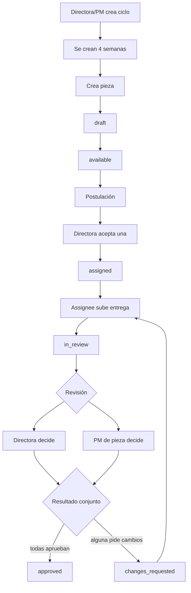
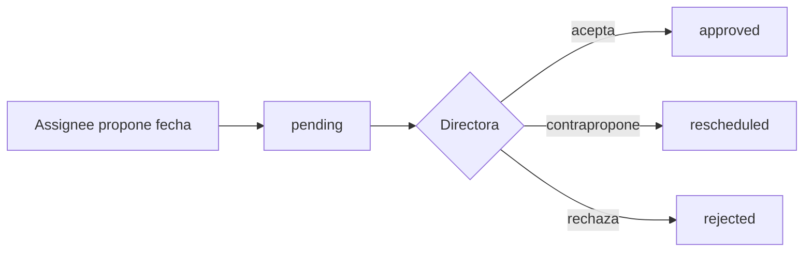
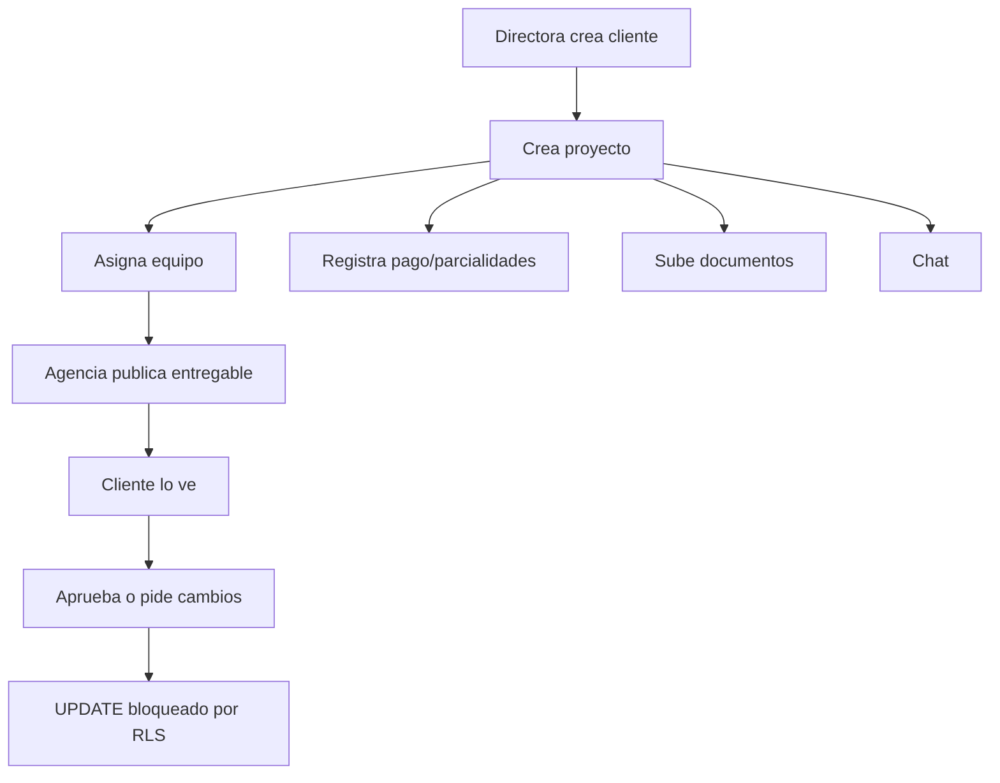
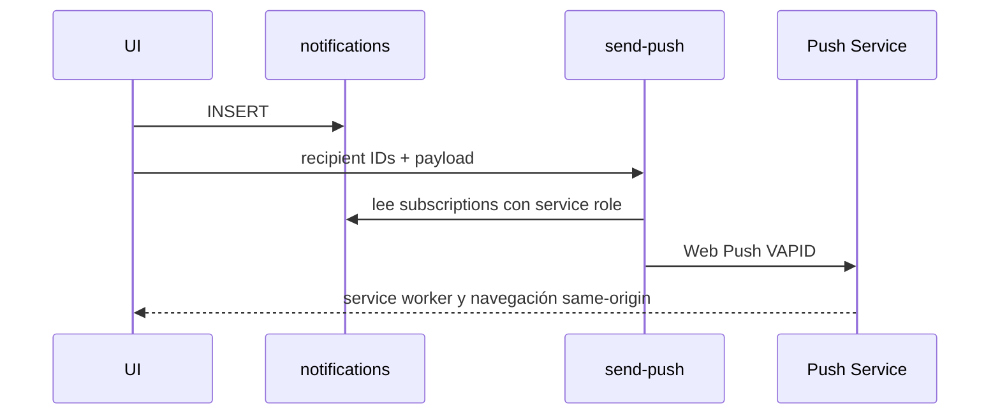
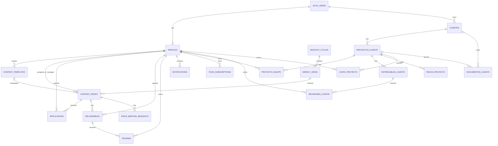

# OMNIA Craft — Legacy System Analysis

> Auditoría de solo lectura realizada el 18 de agosto de 2026.

Este documento describe el repositorio legacy y, cuando se indica expresamente, el esquema real del proyecto Supabase enlazado. No contiene secretos ni valores de variables de entorno.

## Convenciones de evidencia

- **Confirmado por código**: comportamiento visible en el repositorio.
- **Confirmado por Supabase**: objeto o política observado en los catálogos de la instancia enlazada.
- **Inferido**: conclusión razonable que no pudo ejecutarse de extremo a extremo.
- **⚠️ Requiere verificación**: no fue demostrable con el acceso de auditoría.
- En columnas, `!` significa `NOT NULL`, `?` nullable, `PK` primary key y `=…` valor por defecto.

## 1. Executive Summary

OMNIA Craft es una PWA para gestionar producción editorial y, en un segundo dominio parcialmente integrado, clientes y proyectos de agencia. Tiene dos experiencias: operación interna (plantillas, parrillas, piezas, postulaciones, asignación, entregas y revisión dual) y portal de clientes (proyectos, entregables, pagos, documentos, equipo y chat).

El frontend es una SPA React/TypeScript que consulta Supabase directamente desde componentes grandes mediante TanStack Query. No existe una capa de servicios/repositorios consistente. La autorización combina redirecciones React, ocultamiento de UI y RLS; esas capas no coinciden en puntos críticos.

La base real contiene **20 tablas públicas**, **4 roles**, **2 dashboards** y **13 módulos funcionales**. Todas las tablas públicas tienen RLS habilitado, pero varias políticas son demasiado amplias o bloquean funciones ofrecidas por la UI. Se confirmaron **7 problemas críticos**:

1. cualquier autenticado puede cambiar su propio `profiles.role`, incluso a `directora`;
2. cualquier autenticado puede crear notificaciones para cualquier usuario;
3. `send-push` permite a cualquier autenticado enviar contenido arbitrario a IDs o suscripciones suministradas;
4. datos editoriales y perfiles son legibles por todos los autenticados, incluidos clientes;
5. revisión interna inserta la review pero no puede actualizar `deliverables`, dejando estado parcial;
6. el portal muestra aprobar/rechazar al cliente, pero RLS impide actualizar el entregable;
7. Storage expone archivos públicamente y permite mutación transversal en buckets sensibles.

El producto contiene buenas ideas —calendario editorial por ciclos, revisión dual, trazabilidad, portal por proyecto y notificaciones—, pero no conviene reutilizar su código ni su autorización. La reconstrucción requiere límites de dominio, permisos server-side, transacciones/RPC para flujos multitabla y tipos generados desde la base.

**Fuentes:** `src/App.tsx`, `src/features/**`, `src/lib/**`, `src/hooks/**`, `sql/*.sql`, `supabase/functions/send-push/index.ts`, y catálogos reales `pg_catalog`, `information_schema`, `pg_policies`, `pg_proc`, `pg_trigger`, `pg_publication_tables`.

## 2. Technology Stack

| Capa | Tecnología | Uso observado |
|---|---|---|
| Build | Vite 8 | SPA, plugin React y Tailwind |
| UI | React 19.2 + TypeScript 5.9 | Componentes funcionales, TS estricto |
| CSS | Tailwind CSS 4 + variables CSS | Tema oscuro/claro y tokens OMNIA |
| Routing | React Router DOM 7 | Rutas públicas, privadas, por rol y dinámicas |
| Server state | TanStack Query 5 | Queries, mutations e invalidaciones |
| Local state | Zustand 5 | Sidebar y selector de modo, no autorización |
| Forms | React Hook Form + Zod | Uso principal en plantillas; aplicación desigual |
| Backend | Supabase JS 2.99 | Auth, PostgreSQL, Realtime, Storage, Functions |
| Utilidades | date-fns, clsx, tailwind-merge, lucide-react | Fechas, clases e iconos |
| PWA | manifest y service worker manual | Instalación/Web Push; sin caché offline |
| Despliegue | Vercel | Rewrite SPA en `vercel.json` |

Variables referenciadas, sin valores: `VITE_SUPABASE_URL`, `VITE_SUPABASE_ANON_KEY`, `VITE_VAPID_PUBLIC_KEY`, `SUPABASE_URL`, `SUPABASE_SERVICE_ROLE_KEY`, `VAPID_PUBLIC_KEY`, `VAPID_PRIVATE_KEY`, `VAPID_SUBJECT`.

**Fuentes:** `package.json`, `vite.config.ts`, `tsconfig*.json`, `.env.example`, `vercel.json`, `src/lib/supabase.ts`, `public/manifest.json`, `public/sw.js`.

## 3. Repository Architecture

```text
src/
├── App.tsx
├── components/layout, ui
├── features/auth, dashboard, content, grid, review, admin, settings, push
├── features/client-portal
├── hooks
├── lib
├── stores
└── assets
sql/                            # 11 parches; no historial de migraciones
supabase/functions/send-push/   # única Edge Function versionada
public/                         # manifest, SW e iconos
```

La organización por features es reconocible, pero cada página concentra presentación, queries, transformaciones y negocio. Archivos especialmente grandes: `dashboard-page.tsx` (~1,611 líneas), `review-page.tsx` (~1,331), `grid-page.tsx` (~1,258), `piece-detail-drawer.tsx` (~864), `client-project-detail-page.tsx` (~712) y `admin-users-page.tsx` (~584).

No hay tests, Storybook, contrato API, tipos Supabase generados, migraciones ordenadas ni configuración local completa. `README.md` conserva el scaffold de Vite. `PWA_PUSH_SUPABASE_AUDIT_GUIDE.md`, `build-output.txt` y `build-errors.txt` son históricos, no fuentes fiables del estado actual.

**Fuentes:** árbol del repositorio, `README.md`, `package.json`, conteo de líneas.

## 4. Application Domain Model

```text
Identidad
└── Usuario Auth 1:1 Perfil (rol, departamento, contacto)

Editorial
├── Plantilla → Pieza
├── Ciclo mensual → Semana → Piezas
├── Pieza → Postulaciones → Asignación
├── Pieza → Solicitudes de reunión
└── Pieza → Entregas versionadas → Revisiones

Clientes
├── Cliente → Proyectos → Equipo
├── Proyecto → Entregables → Revisiones
├── Proyecto → Pagos
├── Cliente/Proyecto → Documentos
└── Proyecto → Chat
```

Los dominios se conectan por `profiles` pero duplican el concepto de entrega/revisión: `deliverables/reviews` y `entregables_cliente/revisiones_cliente`. No hay entidad tenant/organización; el aislamiento depende de rol, propiedad o membresía.

**Fuentes:** tablas reales, `src/lib/types.ts`, `src/lib/client-types.ts`.

## 5. Authentication

### Estado actual

1. `/login` usa `supabase.auth.signInWithPassword`.
2. `AuthProvider` ejecuta `getSession()`, escucha `onAuthStateChange` y obtiene `profiles` por el UUID Auth.
3. Un storage personalizado duplica el token en IndexedDB (`omnia-craft-auth/auth_storage`) con fallback a `localStorage`.
4. Logout usa `supabase.auth.signOut()`.
5. El trigger real `auth.users.on_auth_user_created` ejecuta `public.handle_new_user()`.
6. No hay signup público en UI. Admin crea/elimina usuarios mediante la Function desplegada `manage-users`, cuya fuente no está en el repo.

`handle_new_user()` copia email, nombre y `raw_user_meta_data.role`; usa `fundador` si falta rol. `profiles.id` referencia Auth con cascade.

### Problema

- Confiar en metadata para el rol sería explotable si signup/control de metadata estuviera abierto.
- `manage-users` tiene `verify_jwt=false`; el Bearer del frontend no demuestra autorización interna.
- No se verificó MFA, password policy, confirmación email, OAuth, rate limits o signup real.

### Recomendación futura

Asignar roles solo server-side, sincronizar claims/perfil transaccionalmente y evitar duplicar tokens salvo amenaza justificada.

**Fuentes:** `src/features/auth/*`, `src/lib/supabase.ts`, `src/features/admin/admin-users-page.tsx`, funciones/triggers reales.

## 6. Users and Roles

No fue posible leer filas de `auth.users` o `profiles`; **identidades y cantidad de usuarios reales son desconocidas**. Se confirmaron cuatro roles:

| Rol exacto | Significado observado | Shell | Asignación |
|---|---|---|---|
| `directora` | Dirección/administración global | Interno y portal agencia | Admin/`manage-users`; también vulnerable a autoescalación |
| `pm` | Project manager | Interno; portal por equipo | Admin/perfil |
| `fundador` | Colaborador/productor | Interno; portal por equipo | Admin/perfil |
| `cliente` | Usuario externo propietario | Portal `/c` | No hay alta en UI admin; vía real no verificada |

El rol vive en `profiles.role` con CHECK. Departamentos: `Marketing`, `Arte y Diseño`, `Desarrollo Web`, `Producción Audiovisual`; no otorgan permisos. Admin solo crea directora/PM/fundador. `clientes` usa `owner_id`; las columnas locales pretendidas `cliente_user_id` y `email_cliente` no existen en producción.

**Fuentes:** constraints reales, `src/lib/types.ts`, `src/App.tsx`, Admin y `src/lib/client-access.ts`.

## 7. Permission Matrix

La matriz combina UI y RLS. “Parcial” marca discrepancia.

| Acción | directora | pm | fundador | cliente |
|---|---:|---:|---:|---:|
| Shell interno | Sí | Sí | Sí | No; fuerza `/c` |
| Ver perfiles/datos editoriales | Sí | Sí | Sí | **DB sí**, sin navegación |
| Gestionar usuarios | UI sí | No | No | No |
| Plantillas | CRUD | Crear/editar | Leer | **DB leer** |
| Crear ciclos/semanas/piezas | Sí | Sí | No | No |
| Editar pieza | Sí | Grid sí/drawer no | DB si asignado | No |
| Eliminar pieza/ciclo | Sí | No | No | No |
| Postular | Sí desde dashboard | Sí desde dashboard | Sí | DB permite si autenticado |
| Asignar postulación | Sí | No | No | No |
| Subir entrega editorial | Si asignada | Si asignado | Si asignado | DB insert propio, sin ruta |
| Revisar | Sí | DB: cualquier PM; UI: PM de pieza | No | No |
| Completar aprobación editorial | **Roto** | **Roto** | No | No |
| Ver clientes/proyectos | Global | Cliente global/proyecto por equipo | Cliente global/proyecto por equipo | Propios |
| Crear cliente | Sí | No | No | No |
| Crear proyecto/pago/documento | UI directora; DB variable | DB más amplio que UI | DB más amplio que UI | No |
| Administrar equipo | Sí | No | No | No |
| Upload entregable cliente | Sí | No UI | UI condicional, **esquema lo impide** | No |
| Aprobar entregable cliente | No | No | No | UI sí, **DB bloquea** |
| Chat | Sí | Por equipo | Por equipo | DB sí, ruta bloquea |
| Cambiar rol propio vía API | Sí | **Sí, a directora** | **Sí, a directora** | **Sí, a directora** |
| Enviar notificación/push a terceros | Sí | Sí | Sí | Sí |

**Fuentes:** `src/App.tsx`, `src/lib/client-permissions.ts`, features y RLS real.

## 8. Database Architecture

- PostgreSQL real: 17.6.
- 20 tablas en `public`; todas con RLS, ninguna con `FORCE ROW LEVEL SECURITY`.
- Sin enums públicos: roles/estados son `text` + CHECK.
- UUID para dominio; `push_subscriptions.id` es `bigint identity`.
- 11 scripts SQL independientes, sin baseline ni orden formal.
- Drift confirmado entre SQL local y producción.
- 23 foreign keys sin índice cuyo primer campo sea la columna referenciante.

El editorial está razonablemente normalizado, salvo archivos duplicados entre `file_url` y `files jsonb`. El portal repite entidades y tiene reglas financieras insuficientes. Flujos relacionados se escriben desde navegador sin transacción.

**Fuentes:** catálogos reales; `sql/*.sql`.

## 9. Database Tables

### Identidad y editorial

| Tabla | Propósito | Columnas reales |
|---|---|---|
| `profiles` | Perfil 1:1 Auth | `id uuid PK!`, `email text!`, `full_name text!=''`, `avatar_url text?`, `role text!='fundador'`, `notification_prefs jsonb?`, `email_notifications bool!=true`, `in_app_notifications bool!=true`, `department text?`, `whatsapp_number text?`, timestamps `!=now()` |
| `content_templates` | Plantillas | `id uuid PK`, `title text!`, `content_type text!='post'`, `description text!=''`, `reference text?`, `platforms jsonb!=[]`, `color text!='#56167d'`, `icon text?`, `is_archived bool!=false`, `created_by uuid!`, timestamps |
| `monthly_cycles` | Ciclos | `id uuid PK`, `name text!`, `objectives text!=''`, `start_date/end_date date!`, `status text!='planning'`, `created_by uuid!`, timestamps |
| `weekly_grids` | Semanas | `id uuid PK`, `cycle_id uuid!`, `week_number int!`, `objectives text!=''`, `start_date/end_date date!`, `status text!='planning'`, `created_by uuid!`, timestamps |
| `content_pieces` | Unidad editorial | `id uuid PK`, `grid_id uuid!`, `template_id uuid?`, `title text!`, `description text!=''`, `platform text!=''`, `status text!='draft'`, `assigned_to uuid?`, `due_date date?`, `review_due_at/final_due_at date?`, `reference text?`, `color text!='#56167d'`, `created_by uuid!`, `piece_pm_user_id uuid?`, timestamps |
| `applications` | Postulaciones | `id uuid PK`, `piece_id/user_id uuid!`, `status text!='pending'`, `created_at` |
| `deliverables` | Entregas versionadas | `id uuid PK`, `piece_id/user_id uuid!`, `file_url text!`, `file_name text!=''`, `files jsonb?=[]`, `comment text?`, `version int!=1`, `status text!='pending_review'`, `created_at` |
| `reviews` | Revisión editorial | `id uuid PK`, `deliverable_id/reviewer_id uuid!`, `content text!=''`, `action text!='comment'`, `created_at` |
| `piece_meeting_requests` | Reuniones | `id uuid PK`, `piece_id/requested_by uuid!`, `proposed_datetime timestamptz!`, `message text?`, `status text!='pending'`, `director_response_message text?`, `counter_proposed_datetime timestamptz?`, timestamps |
| `notifications` | Bandeja in-app | `id uuid PK`, `user_id uuid!`, `type text!='info'`, `title text!`, `message text!=''`, `link text?`, `is_read bool!=false`, `meta jsonb?`, `created_at` |
| `push_subscriptions` | Web Push | `id bigint identity PK`, `owner_id uuid!`, `endpoint/p256dh/auth text!`, timestamps |
| `audit_logs` | Trazas editoriales | `id uuid PK`, `user_id uuid?`, `action/resource_type/resource_id text!`, `meta jsonb?`, `created_at` |

### Portal de clientes

| Tabla | Propósito | Columnas reales |
|---|---|---|
| `clientes` | Empresa cliente | `id uuid PK`, `nombre_empresa text!`, `owner_id uuid!`, `logo_url/notas text?`, timestamps |
| `proyectos_cliente` | Proyecto | `id uuid PK`, `cliente_id uuid!`, `nombre text!`, `descripcion text!=''`, `estado text!='activo'`, `created_by uuid?`, timestamps |
| `proyecto_equipo` | Membresía | `id uuid PK`, `proyecto_id/user_id uuid!`, `rol text!='miembro'`, `created_at` |
| `entregables_cliente` | Entregable al cliente | `id uuid PK`, `proyecto_id uuid!`, `titulo text!`, `descripcion text!=''`, `file_url text?`, `files jsonb!=[]`, `version int!=1`, `estado text!='pending_revision'`, `publicado_por uuid?`, timestamps |
| `revisiones_cliente` | Feedback cliente | `id uuid PK`, `entregable_id/user_id uuid!`, `comentarios text!=''`, `accion text!='comentar'`, `created_at` |
| `pagos_proyecto` | Cobros/parcialidades | `id uuid PK`, `proyecto_id uuid!`, `concepto text!`, `monto numeric(12,2)!=0`, `moneda text!='MXN'`, `estado text!='pendiente'`, fechas pago/vencimiento nullable, `notas text?`, `registrado_por uuid?`, `tipo_pago text!='unico'`, `numero_parcialidad/total_parcialidades int?`, `monto_total numeric?`, timestamps |
| `documentos_cliente` | Archivos cliente/proyecto | `id uuid PK`, `cliente_id/proyecto_id uuid?`, `nombre/file_url text!`, `tipo text!='documento'`, `subido_por uuid?`, `created_at` |
| `chats_proyecto` | Mensajes | `id uuid PK`, `proyecto_id/sender_id uuid!`, `mensaje text!`, `created_at` |

Constraints: CHECKs de roles, departamentos y estados; `week_number` 1..5. UNIQUE en `applications(piece_id,user_id)`, `weekly_grids(cycle_id,week_number)`, `proyecto_equipo(proyecto_id,user_id)`, `push_subscriptions(endpoint)`.

Ausencias: `profiles.email` no es unique; documentos permiten ambos FK nulos o ambos presentes; pagos no exigen monto positivo/consistencia; entregables cliente no tienen asignación.

**Fuente:** esquema real mediante `information_schema`/`pg_catalog`; no se usaron estimaciones de filas.

## 10. Database Relationships

| Relación | Cardinalidad | Delete action / nota |
|---|---|---|
| `auth.users` → `profiles` | 1:0..1 | cascade |
| `profiles` → plantillas/ciclos/semanas/piezas creadas | 1:N | SET NULL incompatible con columnas NOT NULL |
| ciclo → semanas → piezas | 1:N, 1:N | cascade |
| plantilla → piezas | 1:N opcional | set null |
| perfil → piezas asignadas/PM | 1:N | set null |
| pieza → postulaciones/entregas/reuniones | 1:N | cascade |
| entrega → reviews | 1:N | cascade |
| perfil → postulaciones/entregas/reviews | 1:N | cascade |
| perfil → notificaciones/suscripciones | 1:N | cascade |
| Auth user → clientes | 1:N | `owner_id`, cascade |
| cliente → proyectos | 1:N | cascade |
| proyecto → equipo/entregables/pagos/chat | 1:N | cascade |
| entregable cliente → revisiones | 1:N | cascade |
| cliente o proyecto → documentos | 1:N opcional | ambos FK nullable |

Las FK `created_by NOT NULL ON DELETE SET NULL` pueden impedir borrar un perfil creador. Esto puede afectar eliminación administrativa.

**Fuente:** constraints reales.

## 11. RLS Policies

Todas las tablas tienen RLS. Condiciones compactas: `role()` consulta el perfil, `agency()` = `is_agency_member()`, `team(p)` = membresía y `owns(p)` = ownership cliente.

### Identidad/editorial

| Tabla | SELECT | INSERT | UPDATE | DELETE | Evaluación |
|---|---|---|---|---|---|
| `profiles` | todo autenticado | — | `id=auth.uid()` | — | **Crítico:** rol autoeditable |
| `content_templates` | todo autenticado | directora/pm | directora/pm | directora | Cliente también lee |
| `monthly_cycles` | todo autenticado | directora/pm | directora/pm | directora | Global |
| `weekly_grids` | todo autenticado | directora/pm | directora/pm | directora | Global |
| `content_pieces` | todo autenticado | directora/pm | directora/pm o assignee | directora | Assignee actualiza columnas amplias |
| `applications` | propia o directora/pm | `user_id=self` | directora/pm | — | Cualquier rol puede postular |
| `deliverables` | todo autenticado | `user_id=self` | **—** | **—** | Rompe transición de review |
| `reviews` | todo autenticado | directora/pm y reviewer=self | — | — | No valida PM contextual |
| `piece_meeting_requests` | todo autenticado | requester=self | directora | — | Lectura global |
| `notifications` | propia | todo autenticado, destinatario libre | propia | — | Suplantación/spam |
| `push_subscriptions` | propia | propia | propia | propia | Acotada |
| `audit_logs` | directora | todo autenticado | — | — | Escritura no confiable |

### Portal

| Tabla | SELECT | INSERT | UPDATE | DELETE | Evaluación |
|---|---|---|---|---|---|
| `clientes` | agencia o owner | directora | directora | directora | Agencia ve todos |
| `proyectos_cliente` | directora, team o owner | agencia | directora/equipo | directora | INSERT más amplio que UI |
| `proyecto_equipo` | agencia o cliente dueño | directora | directora | directora | Agencia enumera membresías |
| `entregables_cliente` | directora/equipo/owner | agencia/directora/equipo | directora/equipo | — | **Cliente no puede decidir** |
| `revisiones_cliente` | partes con acceso | partes con acceso y user=self | — | — | Frontend casi no la usa |
| `pagos_proyecto` | directora/equipo/owner | agencia | directora | — | INSERT amplio |
| `documentos_cliente` | directora/equipo/owner | agencia; policies solapadas | — | directora | INSERT duplicado/solapado |
| `chats_proyecto` | directora/equipo/owner | mismo y sender=self | — | — | DB permite cliente; router no |

No hay tablas públicas sin RLS, pero el aislamiento es incorrecto. Tras elevarse a directora, un usuario satisface helpers y políticas administrativas.

**Fuente:** `pg_policies` real; contraste con UI.

## 12. PostgreSQL Functions and Triggers

| Función | Entrada/cuándo | Qué hace/retorna |
|---|---|---|
| `handle_new_user()` | AFTER INSERT Auth; `NEW` | Inserta perfil desde metadata; devuelve `NEW` |
| `handle_updated_at()` | BEFORE UPDATE | Asigna `NEW.updated_at=now()`; devuelve `NEW` |
| `get_my_role()` | RLS, sin args | SECURITY DEFINER STABLE; rol actual |
| `is_agency_member()` | RLS | rol en directora/pm/fundador |
| `is_directora()` | RLS | rol directora |
| `is_client_owner(cliente_id)` | UUID | compara `clientes.owner_id` |
| `client_owns_project(proyecto_id)` | UUID | proyecto → cliente → owner |
| `is_on_project_team(proyecto_id)` | UUID | busca membership |
| `rls_auto_enable()` | event trigger | habilita RLS en tablas nuevas `public` |

Los helpers son SECURITY DEFINER; salvo `rls_auto_enable`, no fijan explícitamente `search_path`, aunque califican principalmente tablas `public`.

Triggers reales: alta Auth; `updated_at` solo en `profiles`, templates, pieces, cycles y weeks; event trigger `ensure_rls`. No hay trigger timestamp en portal/subscriptions. El trigger local `enforce_piece_pm_project_pm_distinction` **no está desplegado**. No hay RPC de negocio para flujos atómicos.

**Fuentes:** `pg_proc`, `pg_trigger`, event triggers; `sql/enforce_piece_pm_project_pm_distinction.sql`.

## 13. Supabase Realtime

`useRealtimeSync` se suscribe a pieces, applications, deliverables, reviews, cycles, weeks, meetings y templates, e invalida TanStack Query. También invalida cada 12 segundos y al volver visible la pestaña. `AppLayout` limpia canales, intervalo y listener.

`useNotifications` escucha `notifications`; Chat escucha INSERT de `chats_proyecto`. Ambos limpian canales.

La publicación real incluye **solo `chats_proyecto` y `notifications`**. Las ocho suscripciones editoriales no reciben eventos; la sincronización depende del polling y mutations locales. No hay broadcast/presence. No se demostraron memory leaks. `ClientLayout` no monta el hook global.

**Fuentes:** `src/hooks/use-realtime-sync.ts`, `use-notifications.ts`, Chat, publicación real.

## 14. Supabase Storage

| Bucket usado | Path/contenido | URL | Policies reales | Riesgo |
|---|---|---|---|---|
| `avatars` | avatar aleatorio | `getPublicUrl` | SELECT público; INSERT auth; UPDATE/DELETE cualquier auth | mutación ajena |
| `deliverables` | `piece/timestamp_name` | `getPublicUrl` | SELECT público; CRUD de objeto amplio para auth | exposición/mutación |
| `client-deliverables` | entregables y `docs/client/...` | `getPublicUrl` | SELECT público; INSERT agencia; DELETE directora | documentos expuestos |

No hay owner/path en avatars/deliverables ni límites MIME/tamaño visibles. La UI anuncia 2 MB para avatar sin validación robusta.

⚠️ **Requiere verificación:** no se pudo leer `storage.buckets`; existencia, flag `public`, límites y objetos se infieren de policies y `getPublicUrl`.

**Fuentes:** policies de `storage.objects`, review/settings/portal, `sql/fix_storage.sql`, `avatars-and-delete.sql`.

## 15. Application Modules

Se recuperaron **13 módulos**:

| # | Módulo | Roles/UI | Datos | Estado |
|---:|---|---|---|---|
| 1 | Auth y perfiles | Todos | Auth, profiles | Funcional; rol vulnerable |
| 2 | Dashboard interno | Agencia | dominio editorial | Funcional; queries costosas |
| 3 | Plantillas | Agencia; escribe directora/PM | templates | Funcional |
| 4 | Ciclos, semanas, parrilla/piezas | Agencia; escribe directora/PM | cycles, grids, pieces | Funcional; no atómico |
| 5 | Postulación/asignación | Fundador pretendido; directora decide | applications, pieces | Parcial: otros roles postulan |
| 6 | Entregas/revisión editorial | Assignee, directora, PM de pieza | deliverables, reviews, audit | **Roto por RLS UPDATE** |
| 7 | Solicitudes de reunión | Assignee/directora | meeting requests | Funcional; lectura global |
| 8 | Notificaciones/Web Push | Todos | notifications, subscriptions, Function | Funcional; autorización crítica |
| 9 | Usuarios y ajustes | Directora/todos | Auth, profiles, Storage | Parcial; Function no auditable |
| 10 | Clientes, proyectos, equipo | Portal; gestiona directora | clientes, proyectos, equipo | Parcial por drift |
| 11 | Entregables/revisión cliente | Agencia/cliente | entregables/revisiones cliente | Aprobación rota; upload fundador imposible |
| 12 | Pagos/documentos | Portal | pagos, documentos, Storage | Parcial; reglas débiles |
| 13 | Chat | Agencia/equipo; cliente previsto | chats | Agencia funcional; cliente inalcanzable |

Dependencias: todos usan Auth/profiles; editorial depende de ciclo→semana→pieza; review depende de asignación/Storage; portal de ownership/equipo; push de notificaciones/Function.

**Fuentes:** `src/features/**`, rutas, tablas/policies.

## 16. Dashboards

### Dashboard interno

- **Ruta/rol/layout:** `/`; directora, PM, fundador; `AppLayout`.
- **Cards:** asignadas al usuario, en revisión, aprobadas hoy, disponibles.
- **Widgets:** “Mis piezas” timeline/calendario; disponibles/postulación; “Mis pendientes”.
- **Fechas:** `review_due_at`, `final_due_at`, `due_date`.
- **Acciones:** abrir `?pieceId`, postular, navegar a review/grid, abrir WhatsApp con mensaje.
- **Datos:** pieces, profiles, applications, deliverables, reviews, meetings.
- **Gráficas:** ninguna; métricas son cards/listas.
- **Problemas:** conteos globales, waterfall/N+1 y postulación sin guard de fundador.

### Dashboard del portal

- **Ruta/rol/layout:** `/c`; cliente o agencia; `ClientLayout`.
- **Cards:** proyectos activos, entregables pendientes, pagos pendientes, total de proyectos.
- **Listas:** proyectos/entregables recientes.
- **Scope:** cliente por owner; directora global; PM/fundador por equipo según query/RLS.
- **Datos:** clientes, proyectos, equipo, entregables y pagos.
- **Problema:** alternativas `cliente_user_id/email_cliente` no existen; ownership fiable es `owner_id`.

```text
Login → Dashboard interno → Parrilla → Pieza → Asignar
      → Entrega → Revisión → Aprobada

Login cliente → Dashboard cliente → Proyecto
              → Entregables / Pagos / Documentos
```

**Fuentes:** ambos dashboard pages, layouts y scope helpers.

## 17. Routes and Navigation

| Ruta | Página | Rol router | Propósito | Estado |
|---|---|---|---|---|
| `/login` | Login | Pública | Sesión | Funcional |
| `/` | Dashboard | agencia | Operación editorial | Funcional |
| `/contenido` | Content | agencia; sin RoleGate propio | Plantillas | Funcional; nav puede ocultarla |
| `/parrilla` | Grid | agencia | Ciclos/piezas | Funcional |
| `/revision` | Review | agencia | Entrega/revisión | Parcial roto |
| `/ajustes` | Settings | agencia | Perfil/password/push | Parcial |
| `/admin/usuarios` | AdminUsers | directora | Usuarios | Function no auditable |
| `/c` | ClientDashboard | cliente/agencia | Dashboard portal | Parcial |
| `/c/proyectos` | ClientProjects | cliente/agencia | Clientes/proyectos | Parcial |
| `/c/proyectos/:id` | ProjectDetail | cliente/agencia + RLS | Detalle/tabs | Parcial |
| `/c/entregables` | ClientDeliverables | cliente/agencia | Entregables | Aprobación rota |
| `/c/pagos` | ClientPayments | cliente/agencia | Pagos | Parcial |
| `/c/documentos` | ClientDocuments | cliente/agencia | Documentos | Parcial |
| `/c/chat` | ClientChat | **solo agencyMode** | Chat | Cliente inalcanzable |
| `/c/ajustes` | ClientSettings | cliente/agencia | Ajustes | Funcional |
| wildcards | Redirect | Según shell | Fallback | Funcional |

`ProtectedRoute` exige sesión/perfil; cliente es forzado a `/c`. `AgencyProtectedRoute` limita el shell interno. `RoleGate` solo protege admin. El sidebar oculta links según rol, pero ocultar navegación no protege la URL/DB. `app-mode-store` es preferencia visual.

**Fuentes:** `src/App.tsx`, layouts, `role-gate.tsx`.

## 18. Main User Flows

### Producción editorial



Asignación, upload y review son mutations independientes. En producción review se rompe al actualizar `deliverables`.

### Reuniones



### Portal



### Notificaciones



**Fuentes:** grid/review/portal, `notify.ts`, Function y SW.

## 19. Frontend Architecture

### Inventario

- `App.tsx`: rutas/guards.
- `AppLayout` y `ClientLayout`: shells con sidebar/topbar.
- Features internas y ocho pantallas de portal.
- Reusables limitados: `EmptyState`, `RoleGate`, `OmniaSelect`, notifications popover.
- Hooks: Auth context, notifications, realtime sync, client scope.
- Stores: sidebar y modo.
- Lib: Supabase, tipos manuales, access/permissions, piece PM, review approval, notification routing/dispatch, utils.

No hay `Database` generado. Los tipos manuales divergen del esquema y provocan fallbacks/`any`.

### Visual

Oscuro por defecto y claro con `data-theme`, Inter, tokens morado/azul/rojo/amarillo, cards translúcidas, radios/sombras. Tailwind convive con variables CSS. Logos/favicons están parcialmente duplicados; queda `vite.svg`.

### Validación estática

ESLint local reportó **19 errores y 2 warnings**: Hook condicional en Admin, 12 `any`, dos `setState` síncronos en effects del chat, exports Fast Refresh y dependencia faltante. `pnpm lint` no arrancó porque el gestor fijado no pudo verificar/obtener `pnpm@10.32.1`; el ESLint local sí funcionó.

**Fuentes:** árbol, `src/index.css`, lint local.

## 20. State and Data Flow

```text
UI event
  → useQuery/useMutation dentro de page
  → supabase.from/storage/functions.invoke
  → invalidación Query o state local
  → render
```

- Queries/mutations en páginas; sin repository/service layer.
- TanStack Query para remoto; query keys no centralizadas.
- `useState` para modales/forms/tabs/derivados; Zustand solo shell.
- Auth en context; autorización repartida entre router, JSX, helpers, RLS y Functions.
- Errores: UI, consola o ignorados según flujo.
- Joins/agregados transformados en navegador.
- Actualización por invalidación local, Realtime parcial y polling 12 s.

Inconsistencias: scope duplicado, nombres alternativos de campos en runtime, approvals en cliente, secuencias no atómicas, autorización contextual UI-only.

**Fuentes:** queries/mutations de features, hooks/stores.

## 21. Dependencies

| Categoría | Paquetes | Evaluación |
|---|---|---|
| Fundamental | React, React DOM, TS, Vite | Apropiadas |
| Supabase | JS client, CLI dev | Fundamental; falta tipado generado |
| Routing | react-router-dom | Fundamental |
| Estado remoto | TanStack Query | Correcto, mal encapsulado |
| Estado local | Zustand | Uso mínimo; opcional |
| Forms/validación | RHF, resolvers, Zod | Buen conjunto, uso desigual |
| UI | Tailwind/plugin, Lucide | Activos |
| Utilidades | date-fns, clsx, tailwind-merge, normalize.css | primeras activas; normalize no observado importado |
| PWA | vite-plugin-pwa | Instalado, no configurado |
| Visualización | ninguna | Dashboards sin gráficas |

No se evaluó “abandonada” por antigüedad, sino uso. `vite-plugin-pwa` y posiblemente `normalize.css` son innecesarias hoy. La versión pnpm declarada afectó reproducibilidad.

**Fuentes:** `package.json`, lockfile, imports, `vite.config.ts`.

## 22. Implemented Features

- Login email/password, sesión y perfil.
- Tema, responsive, instalación PWA.
- Plantillas CRUD/archivo.
- Ciclos, semanas, vistas mensual/semanal y piezas.
- Estados/fechas/referencias/PM de pieza.
- Postulación, aceptación/rechazo/asignación.
- Entrega multiarchivo/enlaces y versiones.
- Tabs propias/revisión/aprobadas/historial.
- Solicitudes de reunión.
- Pendientes y acceso a WhatsApp.
- Notificaciones in-app, navegación push y suscripción.
- Administración de usuarios vía Function.
- Clientes, proyectos, equipo, entregables, pagos, documentos y chat.
- Pago único, exhibiciones y MSI calculados en frontend.
- Perfil, avatar, teléfono, contraseña y push.

“Implementado” indica presencia de UI/código; no garantiza que RLS complete el flujo.

**Fuentes:** rutas y `src/features/**`.

## 23. Partial / Unfinished Features

- Revisión editorial: UI completa, transición bloqueada por RLS.
- Aprobación cliente: mutation existe, RLS impide UPDATE.
- Asignación de fundador: helper prueba varios nombres; ninguna columna existe.
- Vínculo cliente por email/ID: producción solo tiene owner; alta guarda email en notas como fallback.
- Realtime editorial: canales declarados pero no publicados.
- Admin: `manage-users` desplegada sin fuente.
- PWA: install/push sí; sin fetch/cache/offline.
- Timestamps portal: columnas sin triggers.
- `revisiones_cliente`: existe, pero el flujo decide por UPDATE directo.
- Semanas: DB permite 1..5; UI crea/filtra 4.

**Fuentes:** código, esquema/RLS/publicación real, SQL local.

## 24. Dead or Unused Functionality

- Rama cliente del Chat soportada por componente/RLS pero bloqueada por ruta.
- Trigger PM distinto presente localmente, ausente en producción.
- Columnas `cliente_user_id/email_cliente` previstas pero no desplegadas.
- `vite-plugin-pwa` sin configurar.
- README de scaffold y guía PWA histórica obsoleta.
- Favicons/assets duplicados y `vite.svg` residual.
- `app-mode-store` no sirve para seguridad.
- `sql/user-management-scripts.sql` mezcla documentación, queries e INSERT placeholder peligroso al ejecutar completo.

**Fuentes:** routing, dependencias, archivos y comparación SQL/DB.

## 25. Technical Debt

| Severidad | Deuda | Evidencia/impacto |
|---|---|---|
| ALTO | Páginas de 700–1,600 líneas | UI/negocio/datos inseparables |
| ALTO | Sin baseline/migraciones | 11 parches y drift |
| ALTO | Mutations no transaccionales | asignación, review, delete, equipo, pagos |
| ALTO | Tipos DB manuales | fallbacks y any |
| ALTO | Sin tests | no script/archivos |
| MEDIO | 23 FK sin índice específico | joins/RLS potencialmente caros |
| MEDIO | Waterfalls/N+1 | dashboards y polling |
| MEDIO | Reglas duplicadas | scope, permissions, approvals, payments |
| MEDIO | Errores ignorados/consola | estado parcial |
| MEDIO | Sin paginación consistente | crecimiento no acotado |
| MEDIO | Timestamps inconsistentes | portal sin triggers |
| BAJO | Docs/assets residuales | onboarding confuso |
| BAJO | Metadata scaffold | paquete `temp-scaffold` |

**Fuentes:** código, estructura, esquema/índices.

## 26. Security Findings

### Críticos

| ID | Hallazgo | Estado actual | Problema | Recomendación futura |
|---|---|---|---|---|
| SEC-01 | Escalación | Perfil propio actualizable sin limitar columnas | Cualquier rol se hace directora | Rol fuera de self-update; RPC admin |
| SEC-02 | Notification spoofing | INSERT con destinatario libre | Spam/suplantación/enlaces | Eventos server-side |
| SEC-03 | Push arbitrario | Auth sin autorizar recipients/payload | Push a IDs o endpoint directo | Destinatarios derivados y payload templates |
| SEC-04 | Lectura transversal | Datos editoriales/perfiles para todo auth | Cliente consulta operación interna | Policies por tenant/membership |
| SEC-05 | Review rota/parcial | INSERT review antes de UPDATE denegado | Estado inconsistente | RPC transaccional contextual |
| SEC-06 | Decisión cliente rota | UI ofrece UPDATE no autorizado | Función prometida falla | RPC de decisión + historial |
| SEC-07 | Storage abierto | Lectura pública/mutación auth amplia | Exposición/borrado/reemplazo | Privado, signed URL, owner/path |

### Altos/medios

- **ALTO:** trigger de alta acepta `raw_user_meta_data.role`; impacto condicionado a signup.
- **ALTO:** cualquier PM puede insertar review sobre cualquier entrega por API.
- **ALTO:** assignee puede UPDATE amplio de su pieza.
- **ALTO:** `manage-users verify_jwt=false`, controles internos desconocidos.
- **ALTO:** SECURITY DEFINER helpers sin `search_path` explícito.
- **MEDIO:** audit log acepta contenido arbitrario; no es evidencia confiable.
- **MEDIO:** documentos con parentesco ambiguo.
- **MEDIO:** validación limitada de enlaces/filenames/payloads. El SW sí restringe navegación same-origin.
- **MEDIO:** logs de error incluyen request body de push/datos de suscripción.
- **MEDIO:** sin límites MIME/tamaño observables.
- **BAJO:** Google Fonts es dependencia externa.

No se encontró service-role en bundle frontend; está en Function. No se incluyeron secretos.

**Fuentes:** RLS/Storage reales, Function, `notify.ts`, push hooks, SW.

## 27. Confirmed Bugs

1. **Review editorial falla y queda insertada.** Luego intenta UPDATE de `deliverables` sin policy.
2. **Cliente no aprueba/pide cambios.** UPDATE de `entregables_cliente` excluye al cliente.
3. **Upload de fundador inalcanzable.** Exige asignación que no existe en esquema.
4. **Chat cliente inalcanzable.** Componente/RLS lo soportan; router redirige.
5. **Vínculo cliente email/ID no persiste como relación.** Fallback guarda email en notas.
6. **Realtime editorial no recibe eventos.** Sus tablas no están publicadas.
7. **Regla PM distinto no aplica en DB.** Trigger local no desplegado.
8. **Hook condicional.** `AdminUsersPage` retorna antes de `useQuery`; lint confirma.
9. **Borrar creadores puede fallar.** `SET NULL` contra `NOT NULL`.
10. **Detalle proyecto muestra todos los documentos del cliente.** Filtra `cliente_id`, no proyecto.
11. **MSI puede no sumar el total.** Cada cuota se redondea sin ajustar residuo.
12. **`updated_at` del portal queda obsoleto.** No hay trigger ni update manual uniforme.

### Riesgos, no bugs demostrados

- El delete de `manage-users` podría compensar las FK; fuente desconocida.
- Metadata de rol depende de signup controlable.
- Flag público exacto de bucket no legible, aunque policies/getPublicUrl exponen.
- Datos históricos podrían tener restricciones operativas no codificadas.

**Fuentes:** código y objetos reales citados en cada punto.

## 28. Architectural Problems

### Arquitectura

- Dos dominios sin boundary de servicios.
- Reglas críticas como secuencias UI, no comandos atómicos.
- DB no reproducible y Function admin no versionada.

### React

- Componentes gigantes, estado derivado/effects.
- Hook condicional y effect dependency confirmados.
- Invalidaciones amplias y queries duplicadas.

### TypeScript

- Tipos manuales divergentes, `any`, casts.
- Fallbacks de “schema cache” esconden drift.
- Estados string distribuidos.

### Base de datos

- Dualidad `file_url/files`; dos modelos de entrega/review.
- Transiciones desde cliente sin state machine.
- Constraints financieros/documentos/email insuficientes.
- FK sin índices; agregados en browser.

### Operación

- Sin tests/pipeline demostrable.
- PWA sin offline.
- Console logs y sin observabilidad estructurada.

**Fuentes:** repositorio y DB real.

## 29. What Should Be Preserved

### Conservar conceptualmente

- Roles diferenciados, después de redefinir responsabilidades.
- Ciclo → semana → pieza.
- Plantillas con plataforma/color/tipo/referencia.
- Postulación previa a asignación y fechas review/final.
- Revisión dual contextual.
- Entregas versionadas, comentarios e historial.
- Reuniones con contrapropuesta.
- Portal por cliente/proyecto con equipo, entregas, pagos, documentos y chat.
- Notificaciones con metadata de navegación y push opt-in.
- Identidad visual OMNIA.

Son capacidades de producto, no código para copiar.

## 30. What Should Be Redesigned

1. Autorización server-side, roles no autoeditables y scopes explícitos.
2. Relación inequívoca Auth/perfil/organización cliente/memberships.
3. State machine editorial y RPC transaccional.
4. Decisión cliente como evento + transición atómica.
5. Buckets privados, metadata normalizada y signed URLs.
6. Outbox/eventos para notificaciones; el cliente no elige recipients.
7. Facturas/parcialidades con constraints y suma exacta.
8. Baseline/migraciones, tipos generados e índices.
9. Frontend por casos de uso con adapters y schemas compartidos.
10. Realtime por scope, sin polling global.
11. Administración versionada, JWT verificado y auditoría confiable.
12. Estrategia PWA única y requisito offline explícito.

## 31. What Should Be Removed

- Fallbacks de columnas inexistentes y `any` permanente.
- Autorización por botones/`app-mode-store`.
- SQL ejemplo mezclado con migraciones.
- Duplicación de tokens Auth sin justificación.
- Polling 12 s y channels no publicados.
- Logs de payloads/suscripciones push.
- Docs scaffold/guías obsoletas/assets Vite.
- Dependencias no configuradas tras confirmación.
- Deletes manuales encadenados cuando DB/RPC debe ser atómica.
- Duplicación de workflows de review si un núcleo compartido mantiene permisos separados.

## 32. Recovered Functional Specification

### Actores

- Dirección administra usuarios, planificación, asignaciones, reviews y portal.
- PM planifica y es segundo revisor cuando se asigna; participa en proyectos por equipo.
- Fundador toma trabajo, entrega y participa en proyectos asignados.
- Cliente consulta sus proyectos y debería decidir entregables, ver pagos/docs y conversar.

### Reglas editoriales

1. Ciclo contiene semanas; pieza pertenece a semana.
2. Pieza recorre `draft → available → assigned → in_review → approved/changes_requested`.
3. Usuario se postula una vez; dirección acepta una y rechaza las otras.
4. Entrega admite varios archivos/enlaces y versión.
5. Dirección revisa; PM de pieza distinto también.
6. Un cambio solicitado devuelve al assignee; todas las aprobaciones completan.
7. Assignee propone reunión; dirección acepta/rechaza/reprograma.

### Reglas del portal

1. Cliente tiene owner Auth y varios proyectos.
2. Proyecto tiene equipo con rol `pm`, `miembro` u `observador`.
3. Entregables/pagos/docs/chat se consultan por ownership o equipo.
4. Dirección gestiona; colaborador publicaría si asignado (intención no soportada).
5. Cliente debería decidir y conversar; hoy está bloqueado total/parcialmente.
6. Pagos soportan único, exhibiciones o MSI y estados controlados por CHECK.

### Transversales

- Notificar eventos in-app/push.
- Navegar desde notificación a pieza/review/portal.
- Mantener perfil, avatar, departamento, teléfono/preferencias.
- Registrar acciones editoriales seleccionadas.

## 33. Database ER Diagram



Solo representa FK reales; relaciones de creador adicionales se condensan.

## 34. Rebuild Considerations

### Secuencia futura

1. Obtener dump estructural/anonimizado y catálogo de datos autorizado.
2. Validar actores/capacidades antes del esquema.
3. Separar `identity`, `editorial`, `client_projects`, `billing`, `files`, `messaging`, `notifications`.
4. Crear baseline de migraciones y tipos generados.
5. Tests RLS por rol y casos negativos.
6. RPC/comandos transaccionales para transiciones.
7. Mapping explícito de estados, owners, equipo, archivos y versiones.
8. Frontend por casos de uso, sin autoridad propia.
9. Unit/integration DB/E2E críticos.
10. Corte progresivo con reconciliación/rollback.

### Decisiones pendientes

- ¿`fundador` es colaborador, socio o ambos?
- ¿PM planifica global pero solo ve proyectos asignados?
- ¿Cliente es organización con varios usuarios?
- ¿Cuándo es obligatoria revisión dual?
- ¿Documento pertenece a cliente, proyecto o uno solo?
- ¿Pagos son tracking o contabilidad?
- ¿PWA requiere offline o solo install/push?

### Criterios mínimos

- Ningún rol se eleva a sí mismo.
- Cada acción tiene tests RLS positivos/negativos.
- Transiciones multitabla atómicas e idempotentes.
- Archivos privados con URL corta.
- DB reproducible desde migraciones.
- Dashboards con queries agregadas/indexadas.
- Permiso visible = permiso efectivo.

## 35. Unknowns / Items Requiring Verification

1. **Usuarios/datos:** identidades, filas, roles, proyectos/historial; auditoría sin SELECT de datos.
2. **Auth:** signup, email confirm, MFA, OAuth, passwords, rate limits.
3. **`manage-users`:** fuente, autorización, service role, delete y audit.
4. **Paridad `send-push`:** desplegado vs fuente local.
5. **Buckets:** flags public, límites, MIME, lifecycle y objetos.
6. **Secret management:** rotación VAPID/service role; valores no inspeccionados.
7. **Integridad histórica:** huérfanos/estados antiguos/drift de filas.
8. **Uso operativo:** pantallas usadas/workarounds manuales.
9. **Canales externos:** WhatsApp solo abre `wa.me`; entrega no verificada.
10. **PWA producción:** iOS/Android/permisos/cache previo.
11. **Rendimiento:** sin `EXPLAIN ANALYZE` ni métricas; índices son hallazgo de catálogo.
12. **Backups/compliance:** restauración, retención y datos personales.
13. **Deploy/CI:** no hay pipeline en repo; Vercel/env de producción no auditados.
14. **Negocio:** estados, vencimientos, revisión dual, fundador y pagos requieren stakeholder.

## Apéndice A — Evidence Map

| Área | Evidencia |
|---|---|
| Routing/guards | `src/App.tsx`, role gate, layouts |
| Auth | `src/features/auth/*`, `supabase.ts`, profile/trigger real |
| Dashboard | ambos dashboard pages |
| Editorial | content/grid/review |
| Portal | client-portal y `lib/client-*` |
| Push | push feature, `notify.ts`, SW, Function |
| Realtime | hooks y publicación real |
| DB/RLS | information_schema, pg_catalog, pg_policies/proc/trigger |
| Storage | policies reales y llamadas Storage |
| SQL local | `sql/*.sql` solo para intención/drift |
| Calidad | ESLint, package/configs, line counts |

## Apéndice B — Foreign Keys Without a Leading Index

`chats_proyecto(proyecto_id,sender_id)`, `clientes(owner_id)`, `content_pieces(created_by,template_id)`, `content_templates(created_by)`, `documentos_cliente(cliente_id,proyecto_id,subido_por)`, `entregables_cliente(proyecto_id,publicado_por)`, `monthly_cycles(created_by)`, `pagos_proyecto(proyecto_id,registrado_por)`, `piece_meeting_requests(piece_id,requested_by)`, `proyecto_equipo(user_id)`, `proyectos_cliente(cliente_id,created_by)`, `reviews(reviewer_id)`, `revisiones_cliente(entregable_id,user_id)`, `weekly_grids(created_by)`.

Esto no demuestra lentitud; requiere planes con datos. Sí marca candidatos por joins, deletes y RLS.

## Apéndice C — Quantitative Summary

| Métrica | Resultado |
|---|---:|
| Tablas públicas | 20 |
| Roles | 4 |
| Departamentos | 4 |
| Dashboards | 2 |
| Módulos | 13 |
| Edge Functions desplegadas | 2 |
| Edge Functions con fuente local | 1 |
| Tablas Realtime | 2 |
| Scripts SQL legacy | 11 |
| Hallazgos críticos | 7 |
| ESLint errores/warnings | 19 / 2 |
